# YoungLionAssets catalog

676 icons across 18 categories.

SVG uses `currentColor`. PNGs have transparent backgrounds.

- [Analytics (15)](#analytics)
- [Commerce (27)](#commerce)
- [Communication (44)](#communication)
- [Creation (12)](#creation)
- [Development (72)](#development)
- [Devices (52)](#devices)
- [Education (13)](#education)
- [Files (130)](#files)
- [Gaming (25)](#gaming)
- [Interface (45)](#interface)
- [Media (43)](#media)
- [Nature (8)](#nature)
- [Navigation (45)](#navigation)
- [Network (55)](#network)
- [People (31)](#people)
- [Security (28)](#security)
- [Time (16)](#time)
- [Travel (15)](#travel)

## Analytics

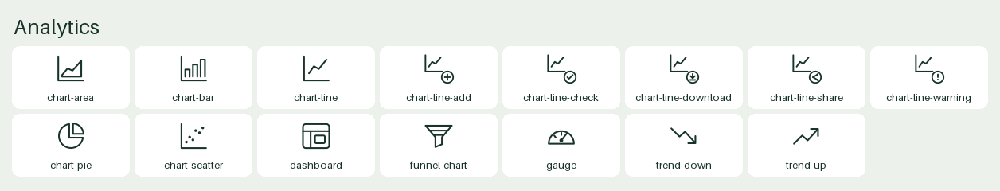

| Icon | SVG | PNG | Light PNG |
| --- | --- | --- | --- |
| `chart-area` | [SVG](assets/svg/analytics/chart-area.svg) | [PNG](assets/png/analytics/chart-area.png) | [PNG](assets/png-light/analytics/chart-area.png) |
| `chart-bar` | [SVG](assets/svg/analytics/chart-bar.svg) | [PNG](assets/png/analytics/chart-bar.png) | [PNG](assets/png-light/analytics/chart-bar.png) |
| `chart-line` | [SVG](assets/svg/analytics/chart-line.svg) | [PNG](assets/png/analytics/chart-line.png) | [PNG](assets/png-light/analytics/chart-line.png) |
| `chart-line-add` | [SVG](assets/svg/analytics/chart-line-add.svg) | [PNG](assets/png/analytics/chart-line-add.png) | [PNG](assets/png-light/analytics/chart-line-add.png) |
| `chart-line-check` | [SVG](assets/svg/analytics/chart-line-check.svg) | [PNG](assets/png/analytics/chart-line-check.png) | [PNG](assets/png-light/analytics/chart-line-check.png) |
| `chart-line-download` | [SVG](assets/svg/analytics/chart-line-download.svg) | [PNG](assets/png/analytics/chart-line-download.png) | [PNG](assets/png-light/analytics/chart-line-download.png) |
| `chart-line-share` | [SVG](assets/svg/analytics/chart-line-share.svg) | [PNG](assets/png/analytics/chart-line-share.png) | [PNG](assets/png-light/analytics/chart-line-share.png) |
| `chart-line-warning` | [SVG](assets/svg/analytics/chart-line-warning.svg) | [PNG](assets/png/analytics/chart-line-warning.png) | [PNG](assets/png-light/analytics/chart-line-warning.png) |
| `chart-pie` | [SVG](assets/svg/analytics/chart-pie.svg) | [PNG](assets/png/analytics/chart-pie.png) | [PNG](assets/png-light/analytics/chart-pie.png) |
| `chart-scatter` | [SVG](assets/svg/analytics/chart-scatter.svg) | [PNG](assets/png/analytics/chart-scatter.png) | [PNG](assets/png-light/analytics/chart-scatter.png) |
| `dashboard` | [SVG](assets/svg/analytics/dashboard.svg) | [PNG](assets/png/analytics/dashboard.png) | [PNG](assets/png-light/analytics/dashboard.png) |
| `funnel-chart` | [SVG](assets/svg/analytics/funnel-chart.svg) | [PNG](assets/png/analytics/funnel-chart.png) | [PNG](assets/png-light/analytics/funnel-chart.png) |
| `gauge` | [SVG](assets/svg/analytics/gauge.svg) | [PNG](assets/png/analytics/gauge.png) | [PNG](assets/png-light/analytics/gauge.png) |
| `trend-down` | [SVG](assets/svg/analytics/trend-down.svg) | [PNG](assets/png/analytics/trend-down.png) | [PNG](assets/png-light/analytics/trend-down.png) |
| `trend-up` | [SVG](assets/svg/analytics/trend-up.svg) | [PNG](assets/png/analytics/trend-up.png) | [PNG](assets/png-light/analytics/trend-up.png) |

## Commerce

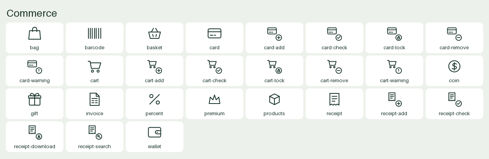

| Icon | SVG | PNG | Light PNG |
| --- | --- | --- | --- |
| `bag` | [SVG](assets/svg/commerce/bag.svg) | [PNG](assets/png/commerce/bag.png) | [PNG](assets/png-light/commerce/bag.png) |
| `barcode` | [SVG](assets/svg/commerce/barcode.svg) | [PNG](assets/png/commerce/barcode.png) | [PNG](assets/png-light/commerce/barcode.png) |
| `basket` | [SVG](assets/svg/commerce/basket.svg) | [PNG](assets/png/commerce/basket.png) | [PNG](assets/png-light/commerce/basket.png) |
| `card` | [SVG](assets/svg/commerce/card.svg) | [PNG](assets/png/commerce/card.png) | [PNG](assets/png-light/commerce/card.png) |
| `card-add` | [SVG](assets/svg/commerce/card-add.svg) | [PNG](assets/png/commerce/card-add.png) | [PNG](assets/png-light/commerce/card-add.png) |
| `card-check` | [SVG](assets/svg/commerce/card-check.svg) | [PNG](assets/png/commerce/card-check.png) | [PNG](assets/png-light/commerce/card-check.png) |
| `card-lock` | [SVG](assets/svg/commerce/card-lock.svg) | [PNG](assets/png/commerce/card-lock.png) | [PNG](assets/png-light/commerce/card-lock.png) |
| `card-remove` | [SVG](assets/svg/commerce/card-remove.svg) | [PNG](assets/png/commerce/card-remove.png) | [PNG](assets/png-light/commerce/card-remove.png) |
| `card-warning` | [SVG](assets/svg/commerce/card-warning.svg) | [PNG](assets/png/commerce/card-warning.png) | [PNG](assets/png-light/commerce/card-warning.png) |
| `cart` | [SVG](assets/svg/commerce/cart.svg) | [PNG](assets/png/commerce/cart.png) | [PNG](assets/png-light/commerce/cart.png) |
| `cart-add` | [SVG](assets/svg/commerce/cart-add.svg) | [PNG](assets/png/commerce/cart-add.png) | [PNG](assets/png-light/commerce/cart-add.png) |
| `cart-check` | [SVG](assets/svg/commerce/cart-check.svg) | [PNG](assets/png/commerce/cart-check.png) | [PNG](assets/png-light/commerce/cart-check.png) |
| `cart-lock` | [SVG](assets/svg/commerce/cart-lock.svg) | [PNG](assets/png/commerce/cart-lock.png) | [PNG](assets/png-light/commerce/cart-lock.png) |
| `cart-remove` | [SVG](assets/svg/commerce/cart-remove.svg) | [PNG](assets/png/commerce/cart-remove.png) | [PNG](assets/png-light/commerce/cart-remove.png) |
| `cart-warning` | [SVG](assets/svg/commerce/cart-warning.svg) | [PNG](assets/png/commerce/cart-warning.png) | [PNG](assets/png-light/commerce/cart-warning.png) |
| `coin` | [SVG](assets/svg/commerce/coin.svg) | [PNG](assets/png/commerce/coin.png) | [PNG](assets/png-light/commerce/coin.png) |
| `gift` | [SVG](assets/svg/commerce/gift.svg) | [PNG](assets/png/commerce/gift.png) | [PNG](assets/png-light/commerce/gift.png) |
| `invoice` | [SVG](assets/svg/commerce/invoice.svg) | [PNG](assets/png/commerce/invoice.png) | [PNG](assets/png-light/commerce/invoice.png) |
| `percent` | [SVG](assets/svg/commerce/percent.svg) | [PNG](assets/png/commerce/percent.png) | [PNG](assets/png-light/commerce/percent.png) |
| `premium` | [SVG](assets/svg/commerce/premium.svg) | [PNG](assets/png/commerce/premium.png) | [PNG](assets/png-light/commerce/premium.png) |
| `products` | [SVG](assets/svg/commerce/products.svg) | [PNG](assets/png/commerce/products.png) | [PNG](assets/png-light/commerce/products.png) |
| `receipt` | [SVG](assets/svg/commerce/receipt.svg) | [PNG](assets/png/commerce/receipt.png) | [PNG](assets/png-light/commerce/receipt.png) |
| `receipt-add` | [SVG](assets/svg/commerce/receipt-add.svg) | [PNG](assets/png/commerce/receipt-add.png) | [PNG](assets/png-light/commerce/receipt-add.png) |
| `receipt-check` | [SVG](assets/svg/commerce/receipt-check.svg) | [PNG](assets/png/commerce/receipt-check.png) | [PNG](assets/png-light/commerce/receipt-check.png) |
| `receipt-download` | [SVG](assets/svg/commerce/receipt-download.svg) | [PNG](assets/png/commerce/receipt-download.png) | [PNG](assets/png-light/commerce/receipt-download.png) |
| `receipt-search` | [SVG](assets/svg/commerce/receipt-search.svg) | [PNG](assets/png/commerce/receipt-search.png) | [PNG](assets/png-light/commerce/receipt-search.png) |
| `wallet` | [SVG](assets/svg/commerce/wallet.svg) | [PNG](assets/png/commerce/wallet.png) | [PNG](assets/png-light/commerce/wallet.png) |

## Communication

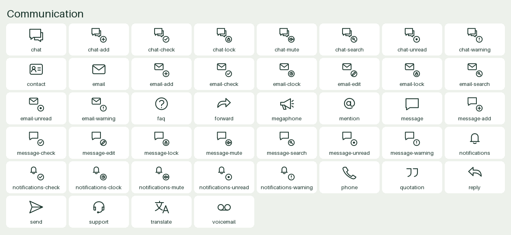

| Icon | SVG | PNG | Light PNG |
| --- | --- | --- | --- |
| `chat` | [SVG](assets/svg/communication/chat.svg) | [PNG](assets/png/communication/chat.png) | [PNG](assets/png-light/communication/chat.png) |
| `chat-add` | [SVG](assets/svg/communication/chat-add.svg) | [PNG](assets/png/communication/chat-add.png) | [PNG](assets/png-light/communication/chat-add.png) |
| `chat-check` | [SVG](assets/svg/communication/chat-check.svg) | [PNG](assets/png/communication/chat-check.png) | [PNG](assets/png-light/communication/chat-check.png) |
| `chat-lock` | [SVG](assets/svg/communication/chat-lock.svg) | [PNG](assets/png/communication/chat-lock.png) | [PNG](assets/png-light/communication/chat-lock.png) |
| `chat-mute` | [SVG](assets/svg/communication/chat-mute.svg) | [PNG](assets/png/communication/chat-mute.png) | [PNG](assets/png-light/communication/chat-mute.png) |
| `chat-search` | [SVG](assets/svg/communication/chat-search.svg) | [PNG](assets/png/communication/chat-search.png) | [PNG](assets/png-light/communication/chat-search.png) |
| `chat-unread` | [SVG](assets/svg/communication/chat-unread.svg) | [PNG](assets/png/communication/chat-unread.png) | [PNG](assets/png-light/communication/chat-unread.png) |
| `chat-warning` | [SVG](assets/svg/communication/chat-warning.svg) | [PNG](assets/png/communication/chat-warning.png) | [PNG](assets/png-light/communication/chat-warning.png) |
| `contact` | [SVG](assets/svg/communication/contact.svg) | [PNG](assets/png/communication/contact.png) | [PNG](assets/png-light/communication/contact.png) |
| `email` | [SVG](assets/svg/communication/email.svg) | [PNG](assets/png/communication/email.png) | [PNG](assets/png-light/communication/email.png) |
| `email-add` | [SVG](assets/svg/communication/email-add.svg) | [PNG](assets/png/communication/email-add.png) | [PNG](assets/png-light/communication/email-add.png) |
| `email-check` | [SVG](assets/svg/communication/email-check.svg) | [PNG](assets/png/communication/email-check.png) | [PNG](assets/png-light/communication/email-check.png) |
| `email-clock` | [SVG](assets/svg/communication/email-clock.svg) | [PNG](assets/png/communication/email-clock.png) | [PNG](assets/png-light/communication/email-clock.png) |
| `email-edit` | [SVG](assets/svg/communication/email-edit.svg) | [PNG](assets/png/communication/email-edit.png) | [PNG](assets/png-light/communication/email-edit.png) |
| `email-lock` | [SVG](assets/svg/communication/email-lock.svg) | [PNG](assets/png/communication/email-lock.png) | [PNG](assets/png-light/communication/email-lock.png) |
| `email-search` | [SVG](assets/svg/communication/email-search.svg) | [PNG](assets/png/communication/email-search.png) | [PNG](assets/png-light/communication/email-search.png) |
| `email-unread` | [SVG](assets/svg/communication/email-unread.svg) | [PNG](assets/png/communication/email-unread.png) | [PNG](assets/png-light/communication/email-unread.png) |
| `email-warning` | [SVG](assets/svg/communication/email-warning.svg) | [PNG](assets/png/communication/email-warning.png) | [PNG](assets/png-light/communication/email-warning.png) |
| `faq` | [SVG](assets/svg/communication/faq.svg) | [PNG](assets/png/communication/faq.png) | [PNG](assets/png-light/communication/faq.png) |
| `forward` | [SVG](assets/svg/communication/forward.svg) | [PNG](assets/png/communication/forward.png) | [PNG](assets/png-light/communication/forward.png) |
| `megaphone` | [SVG](assets/svg/communication/megaphone.svg) | [PNG](assets/png/communication/megaphone.png) | [PNG](assets/png-light/communication/megaphone.png) |
| `mention` | [SVG](assets/svg/communication/mention.svg) | [PNG](assets/png/communication/mention.png) | [PNG](assets/png-light/communication/mention.png) |
| `message` | [SVG](assets/svg/communication/message.svg) | [PNG](assets/png/communication/message.png) | [PNG](assets/png-light/communication/message.png) |
| `message-add` | [SVG](assets/svg/communication/message-add.svg) | [PNG](assets/png/communication/message-add.png) | [PNG](assets/png-light/communication/message-add.png) |
| `message-check` | [SVG](assets/svg/communication/message-check.svg) | [PNG](assets/png/communication/message-check.png) | [PNG](assets/png-light/communication/message-check.png) |
| `message-edit` | [SVG](assets/svg/communication/message-edit.svg) | [PNG](assets/png/communication/message-edit.png) | [PNG](assets/png-light/communication/message-edit.png) |
| `message-lock` | [SVG](assets/svg/communication/message-lock.svg) | [PNG](assets/png/communication/message-lock.png) | [PNG](assets/png-light/communication/message-lock.png) |
| `message-mute` | [SVG](assets/svg/communication/message-mute.svg) | [PNG](assets/png/communication/message-mute.png) | [PNG](assets/png-light/communication/message-mute.png) |
| `message-search` | [SVG](assets/svg/communication/message-search.svg) | [PNG](assets/png/communication/message-search.png) | [PNG](assets/png-light/communication/message-search.png) |
| `message-unread` | [SVG](assets/svg/communication/message-unread.svg) | [PNG](assets/png/communication/message-unread.png) | [PNG](assets/png-light/communication/message-unread.png) |
| `message-warning` | [SVG](assets/svg/communication/message-warning.svg) | [PNG](assets/png/communication/message-warning.png) | [PNG](assets/png-light/communication/message-warning.png) |
| `notifications` | [SVG](assets/svg/communication/notifications.svg) | [PNG](assets/png/communication/notifications.png) | [PNG](assets/png-light/communication/notifications.png) |
| `notifications-check` | [SVG](assets/svg/communication/notifications-check.svg) | [PNG](assets/png/communication/notifications-check.png) | [PNG](assets/png-light/communication/notifications-check.png) |
| `notifications-clock` | [SVG](assets/svg/communication/notifications-clock.svg) | [PNG](assets/png/communication/notifications-clock.png) | [PNG](assets/png-light/communication/notifications-clock.png) |
| `notifications-mute` | [SVG](assets/svg/communication/notifications-mute.svg) | [PNG](assets/png/communication/notifications-mute.png) | [PNG](assets/png-light/communication/notifications-mute.png) |
| `notifications-unread` | [SVG](assets/svg/communication/notifications-unread.svg) | [PNG](assets/png/communication/notifications-unread.png) | [PNG](assets/png-light/communication/notifications-unread.png) |
| `notifications-warning` | [SVG](assets/svg/communication/notifications-warning.svg) | [PNG](assets/png/communication/notifications-warning.png) | [PNG](assets/png-light/communication/notifications-warning.png) |
| `phone` | [SVG](assets/svg/communication/phone.svg) | [PNG](assets/png/communication/phone.png) | [PNG](assets/png-light/communication/phone.png) |
| `quotation` | [SVG](assets/svg/communication/quotation.svg) | [PNG](assets/png/communication/quotation.png) | [PNG](assets/png-light/communication/quotation.png) |
| `reply` | [SVG](assets/svg/communication/reply.svg) | [PNG](assets/png/communication/reply.png) | [PNG](assets/png-light/communication/reply.png) |
| `send` | [SVG](assets/svg/communication/send.svg) | [PNG](assets/png/communication/send.png) | [PNG](assets/png-light/communication/send.png) |
| `support` | [SVG](assets/svg/communication/support.svg) | [PNG](assets/png/communication/support.png) | [PNG](assets/png-light/communication/support.png) |
| `translate` | [SVG](assets/svg/communication/translate.svg) | [PNG](assets/png/communication/translate.png) | [PNG](assets/png-light/communication/translate.png) |
| `voicemail` | [SVG](assets/svg/communication/voicemail.svg) | [PNG](assets/png/communication/voicemail.png) | [PNG](assets/png-light/communication/voicemail.png) |

## Creation

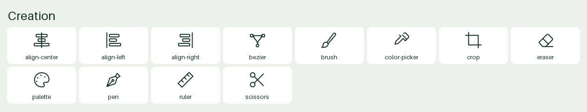

| Icon | SVG | PNG | Light PNG |
| --- | --- | --- | --- |
| `align-center` | [SVG](assets/svg/creation/align-center.svg) | [PNG](assets/png/creation/align-center.png) | [PNG](assets/png-light/creation/align-center.png) |
| `align-left` | [SVG](assets/svg/creation/align-left.svg) | [PNG](assets/png/creation/align-left.png) | [PNG](assets/png-light/creation/align-left.png) |
| `align-right` | [SVG](assets/svg/creation/align-right.svg) | [PNG](assets/png/creation/align-right.png) | [PNG](assets/png-light/creation/align-right.png) |
| `bezier` | [SVG](assets/svg/creation/bezier.svg) | [PNG](assets/png/creation/bezier.png) | [PNG](assets/png-light/creation/bezier.png) |
| `brush` | [SVG](assets/svg/creation/brush.svg) | [PNG](assets/png/creation/brush.png) | [PNG](assets/png-light/creation/brush.png) |
| `color-picker` | [SVG](assets/svg/creation/color-picker.svg) | [PNG](assets/png/creation/color-picker.png) | [PNG](assets/png-light/creation/color-picker.png) |
| `crop` | [SVG](assets/svg/creation/crop.svg) | [PNG](assets/png/creation/crop.png) | [PNG](assets/png-light/creation/crop.png) |
| `eraser` | [SVG](assets/svg/creation/eraser.svg) | [PNG](assets/png/creation/eraser.png) | [PNG](assets/png-light/creation/eraser.png) |
| `palette` | [SVG](assets/svg/creation/palette.svg) | [PNG](assets/png/creation/palette.png) | [PNG](assets/png-light/creation/palette.png) |
| `pen` | [SVG](assets/svg/creation/pen.svg) | [PNG](assets/png/creation/pen.png) | [PNG](assets/png-light/creation/pen.png) |
| `ruler` | [SVG](assets/svg/creation/ruler.svg) | [PNG](assets/png/creation/ruler.png) | [PNG](assets/png-light/creation/ruler.png) |
| `scissors` | [SVG](assets/svg/creation/scissors.svg) | [PNG](assets/png/creation/scissors.png) | [PNG](assets/png-light/creation/scissors.png) |

## Development

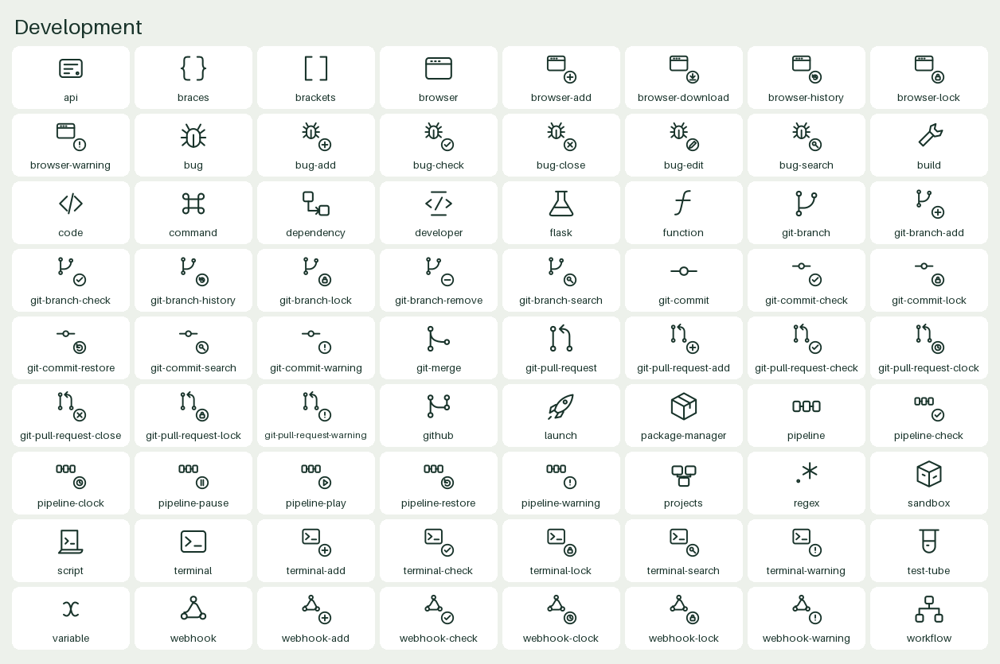

| Icon | SVG | PNG | Light PNG |
| --- | --- | --- | --- |
| `api` | [SVG](assets/svg/development/api.svg) | [PNG](assets/png/development/api.png) | [PNG](assets/png-light/development/api.png) |
| `braces` | [SVG](assets/svg/development/braces.svg) | [PNG](assets/png/development/braces.png) | [PNG](assets/png-light/development/braces.png) |
| `brackets` | [SVG](assets/svg/development/brackets.svg) | [PNG](assets/png/development/brackets.png) | [PNG](assets/png-light/development/brackets.png) |
| `browser` | [SVG](assets/svg/development/browser.svg) | [PNG](assets/png/development/browser.png) | [PNG](assets/png-light/development/browser.png) |
| `browser-add` | [SVG](assets/svg/development/browser-add.svg) | [PNG](assets/png/development/browser-add.png) | [PNG](assets/png-light/development/browser-add.png) |
| `browser-download` | [SVG](assets/svg/development/browser-download.svg) | [PNG](assets/png/development/browser-download.png) | [PNG](assets/png-light/development/browser-download.png) |
| `browser-history` | [SVG](assets/svg/development/browser-history.svg) | [PNG](assets/png/development/browser-history.png) | [PNG](assets/png-light/development/browser-history.png) |
| `browser-lock` | [SVG](assets/svg/development/browser-lock.svg) | [PNG](assets/png/development/browser-lock.png) | [PNG](assets/png-light/development/browser-lock.png) |
| `browser-warning` | [SVG](assets/svg/development/browser-warning.svg) | [PNG](assets/png/development/browser-warning.png) | [PNG](assets/png-light/development/browser-warning.png) |
| `bug` | [SVG](assets/svg/development/bug.svg) | [PNG](assets/png/development/bug.png) | [PNG](assets/png-light/development/bug.png) |
| `bug-add` | [SVG](assets/svg/development/bug-add.svg) | [PNG](assets/png/development/bug-add.png) | [PNG](assets/png-light/development/bug-add.png) |
| `bug-check` | [SVG](assets/svg/development/bug-check.svg) | [PNG](assets/png/development/bug-check.png) | [PNG](assets/png-light/development/bug-check.png) |
| `bug-close` | [SVG](assets/svg/development/bug-close.svg) | [PNG](assets/png/development/bug-close.png) | [PNG](assets/png-light/development/bug-close.png) |
| `bug-edit` | [SVG](assets/svg/development/bug-edit.svg) | [PNG](assets/png/development/bug-edit.png) | [PNG](assets/png-light/development/bug-edit.png) |
| `bug-search` | [SVG](assets/svg/development/bug-search.svg) | [PNG](assets/png/development/bug-search.png) | [PNG](assets/png-light/development/bug-search.png) |
| `build` | [SVG](assets/svg/development/build.svg) | [PNG](assets/png/development/build.png) | [PNG](assets/png-light/development/build.png) |
| `code` | [SVG](assets/svg/development/code.svg) | [PNG](assets/png/development/code.png) | [PNG](assets/png-light/development/code.png) |
| `command` | [SVG](assets/svg/development/command.svg) | [PNG](assets/png/development/command.png) | [PNG](assets/png-light/development/command.png) |
| `dependency` | [SVG](assets/svg/development/dependency.svg) | [PNG](assets/png/development/dependency.png) | [PNG](assets/png-light/development/dependency.png) |
| `developer` | [SVG](assets/svg/development/developer.svg) | [PNG](assets/png/development/developer.png) | [PNG](assets/png-light/development/developer.png) |
| `flask` | [SVG](assets/svg/development/flask.svg) | [PNG](assets/png/development/flask.png) | [PNG](assets/png-light/development/flask.png) |
| `function` | [SVG](assets/svg/development/function.svg) | [PNG](assets/png/development/function.png) | [PNG](assets/png-light/development/function.png) |
| `git-branch` | [SVG](assets/svg/development/git-branch.svg) | [PNG](assets/png/development/git-branch.png) | [PNG](assets/png-light/development/git-branch.png) |
| `git-branch-add` | [SVG](assets/svg/development/git-branch-add.svg) | [PNG](assets/png/development/git-branch-add.png) | [PNG](assets/png-light/development/git-branch-add.png) |
| `git-branch-check` | [SVG](assets/svg/development/git-branch-check.svg) | [PNG](assets/png/development/git-branch-check.png) | [PNG](assets/png-light/development/git-branch-check.png) |
| `git-branch-history` | [SVG](assets/svg/development/git-branch-history.svg) | [PNG](assets/png/development/git-branch-history.png) | [PNG](assets/png-light/development/git-branch-history.png) |
| `git-branch-lock` | [SVG](assets/svg/development/git-branch-lock.svg) | [PNG](assets/png/development/git-branch-lock.png) | [PNG](assets/png-light/development/git-branch-lock.png) |
| `git-branch-remove` | [SVG](assets/svg/development/git-branch-remove.svg) | [PNG](assets/png/development/git-branch-remove.png) | [PNG](assets/png-light/development/git-branch-remove.png) |
| `git-branch-search` | [SVG](assets/svg/development/git-branch-search.svg) | [PNG](assets/png/development/git-branch-search.png) | [PNG](assets/png-light/development/git-branch-search.png) |
| `git-commit` | [SVG](assets/svg/development/git-commit.svg) | [PNG](assets/png/development/git-commit.png) | [PNG](assets/png-light/development/git-commit.png) |
| `git-commit-check` | [SVG](assets/svg/development/git-commit-check.svg) | [PNG](assets/png/development/git-commit-check.png) | [PNG](assets/png-light/development/git-commit-check.png) |
| `git-commit-lock` | [SVG](assets/svg/development/git-commit-lock.svg) | [PNG](assets/png/development/git-commit-lock.png) | [PNG](assets/png-light/development/git-commit-lock.png) |
| `git-commit-restore` | [SVG](assets/svg/development/git-commit-restore.svg) | [PNG](assets/png/development/git-commit-restore.png) | [PNG](assets/png-light/development/git-commit-restore.png) |
| `git-commit-search` | [SVG](assets/svg/development/git-commit-search.svg) | [PNG](assets/png/development/git-commit-search.png) | [PNG](assets/png-light/development/git-commit-search.png) |
| `git-commit-warning` | [SVG](assets/svg/development/git-commit-warning.svg) | [PNG](assets/png/development/git-commit-warning.png) | [PNG](assets/png-light/development/git-commit-warning.png) |
| `git-merge` | [SVG](assets/svg/development/git-merge.svg) | [PNG](assets/png/development/git-merge.png) | [PNG](assets/png-light/development/git-merge.png) |
| `git-pull-request` | [SVG](assets/svg/development/git-pull-request.svg) | [PNG](assets/png/development/git-pull-request.png) | [PNG](assets/png-light/development/git-pull-request.png) |
| `git-pull-request-add` | [SVG](assets/svg/development/git-pull-request-add.svg) | [PNG](assets/png/development/git-pull-request-add.png) | [PNG](assets/png-light/development/git-pull-request-add.png) |
| `git-pull-request-check` | [SVG](assets/svg/development/git-pull-request-check.svg) | [PNG](assets/png/development/git-pull-request-check.png) | [PNG](assets/png-light/development/git-pull-request-check.png) |
| `git-pull-request-clock` | [SVG](assets/svg/development/git-pull-request-clock.svg) | [PNG](assets/png/development/git-pull-request-clock.png) | [PNG](assets/png-light/development/git-pull-request-clock.png) |
| `git-pull-request-close` | [SVG](assets/svg/development/git-pull-request-close.svg) | [PNG](assets/png/development/git-pull-request-close.png) | [PNG](assets/png-light/development/git-pull-request-close.png) |
| `git-pull-request-lock` | [SVG](assets/svg/development/git-pull-request-lock.svg) | [PNG](assets/png/development/git-pull-request-lock.png) | [PNG](assets/png-light/development/git-pull-request-lock.png) |
| `git-pull-request-warning` | [SVG](assets/svg/development/git-pull-request-warning.svg) | [PNG](assets/png/development/git-pull-request-warning.png) | [PNG](assets/png-light/development/git-pull-request-warning.png) |
| `github` | [SVG](assets/svg/development/github.svg) | [PNG](assets/png/development/github.png) | [PNG](assets/png-light/development/github.png) |
| `launch` | [SVG](assets/svg/development/launch.svg) | [PNG](assets/png/development/launch.png) | [PNG](assets/png-light/development/launch.png) |
| `package-manager` | [SVG](assets/svg/development/package-manager.svg) | [PNG](assets/png/development/package-manager.png) | [PNG](assets/png-light/development/package-manager.png) |
| `pipeline` | [SVG](assets/svg/development/pipeline.svg) | [PNG](assets/png/development/pipeline.png) | [PNG](assets/png-light/development/pipeline.png) |
| `pipeline-check` | [SVG](assets/svg/development/pipeline-check.svg) | [PNG](assets/png/development/pipeline-check.png) | [PNG](assets/png-light/development/pipeline-check.png) |
| `pipeline-clock` | [SVG](assets/svg/development/pipeline-clock.svg) | [PNG](assets/png/development/pipeline-clock.png) | [PNG](assets/png-light/development/pipeline-clock.png) |
| `pipeline-pause` | [SVG](assets/svg/development/pipeline-pause.svg) | [PNG](assets/png/development/pipeline-pause.png) | [PNG](assets/png-light/development/pipeline-pause.png) |
| `pipeline-play` | [SVG](assets/svg/development/pipeline-play.svg) | [PNG](assets/png/development/pipeline-play.png) | [PNG](assets/png-light/development/pipeline-play.png) |
| `pipeline-restore` | [SVG](assets/svg/development/pipeline-restore.svg) | [PNG](assets/png/development/pipeline-restore.png) | [PNG](assets/png-light/development/pipeline-restore.png) |
| `pipeline-warning` | [SVG](assets/svg/development/pipeline-warning.svg) | [PNG](assets/png/development/pipeline-warning.png) | [PNG](assets/png-light/development/pipeline-warning.png) |
| `projects` | [SVG](assets/svg/development/projects.svg) | [PNG](assets/png/development/projects.png) | [PNG](assets/png-light/development/projects.png) |
| `regex` | [SVG](assets/svg/development/regex.svg) | [PNG](assets/png/development/regex.png) | [PNG](assets/png-light/development/regex.png) |
| `sandbox` | [SVG](assets/svg/development/sandbox.svg) | [PNG](assets/png/development/sandbox.png) | [PNG](assets/png-light/development/sandbox.png) |
| `script` | [SVG](assets/svg/development/script.svg) | [PNG](assets/png/development/script.png) | [PNG](assets/png-light/development/script.png) |
| `terminal` | [SVG](assets/svg/development/terminal.svg) | [PNG](assets/png/development/terminal.png) | [PNG](assets/png-light/development/terminal.png) |
| `terminal-add` | [SVG](assets/svg/development/terminal-add.svg) | [PNG](assets/png/development/terminal-add.png) | [PNG](assets/png-light/development/terminal-add.png) |
| `terminal-check` | [SVG](assets/svg/development/terminal-check.svg) | [PNG](assets/png/development/terminal-check.png) | [PNG](assets/png-light/development/terminal-check.png) |
| `terminal-lock` | [SVG](assets/svg/development/terminal-lock.svg) | [PNG](assets/png/development/terminal-lock.png) | [PNG](assets/png-light/development/terminal-lock.png) |
| `terminal-search` | [SVG](assets/svg/development/terminal-search.svg) | [PNG](assets/png/development/terminal-search.png) | [PNG](assets/png-light/development/terminal-search.png) |
| `terminal-warning` | [SVG](assets/svg/development/terminal-warning.svg) | [PNG](assets/png/development/terminal-warning.png) | [PNG](assets/png-light/development/terminal-warning.png) |
| `test-tube` | [SVG](assets/svg/development/test-tube.svg) | [PNG](assets/png/development/test-tube.png) | [PNG](assets/png-light/development/test-tube.png) |
| `variable` | [SVG](assets/svg/development/variable.svg) | [PNG](assets/png/development/variable.png) | [PNG](assets/png-light/development/variable.png) |
| `webhook` | [SVG](assets/svg/development/webhook.svg) | [PNG](assets/png/development/webhook.png) | [PNG](assets/png-light/development/webhook.png) |
| `webhook-add` | [SVG](assets/svg/development/webhook-add.svg) | [PNG](assets/png/development/webhook-add.png) | [PNG](assets/png-light/development/webhook-add.png) |
| `webhook-check` | [SVG](assets/svg/development/webhook-check.svg) | [PNG](assets/png/development/webhook-check.png) | [PNG](assets/png-light/development/webhook-check.png) |
| `webhook-clock` | [SVG](assets/svg/development/webhook-clock.svg) | [PNG](assets/png/development/webhook-clock.png) | [PNG](assets/png-light/development/webhook-clock.png) |
| `webhook-lock` | [SVG](assets/svg/development/webhook-lock.svg) | [PNG](assets/png/development/webhook-lock.png) | [PNG](assets/png-light/development/webhook-lock.png) |
| `webhook-warning` | [SVG](assets/svg/development/webhook-warning.svg) | [PNG](assets/png/development/webhook-warning.png) | [PNG](assets/png-light/development/webhook-warning.png) |
| `workflow` | [SVG](assets/svg/development/workflow.svg) | [PNG](assets/png/development/workflow.png) | [PNG](assets/png-light/development/workflow.png) |

## Devices

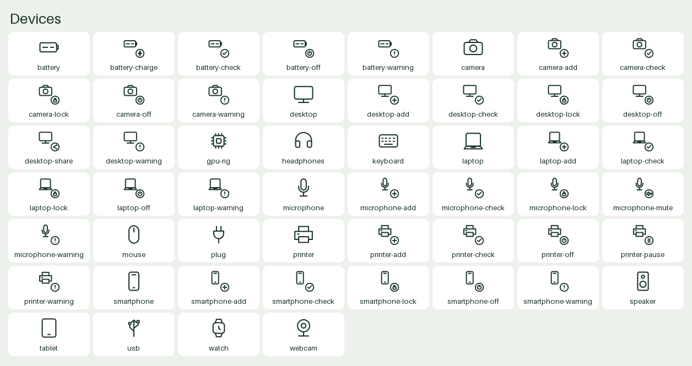

| Icon | SVG | PNG | Light PNG |
| --- | --- | --- | --- |
| `battery` | [SVG](assets/svg/devices/battery.svg) | [PNG](assets/png/devices/battery.png) | [PNG](assets/png-light/devices/battery.png) |
| `battery-charge` | [SVG](assets/svg/devices/battery-charge.svg) | [PNG](assets/png/devices/battery-charge.png) | [PNG](assets/png-light/devices/battery-charge.png) |
| `battery-check` | [SVG](assets/svg/devices/battery-check.svg) | [PNG](assets/png/devices/battery-check.png) | [PNG](assets/png-light/devices/battery-check.png) |
| `battery-off` | [SVG](assets/svg/devices/battery-off.svg) | [PNG](assets/png/devices/battery-off.png) | [PNG](assets/png-light/devices/battery-off.png) |
| `battery-warning` | [SVG](assets/svg/devices/battery-warning.svg) | [PNG](assets/png/devices/battery-warning.png) | [PNG](assets/png-light/devices/battery-warning.png) |
| `camera` | [SVG](assets/svg/devices/camera.svg) | [PNG](assets/png/devices/camera.png) | [PNG](assets/png-light/devices/camera.png) |
| `camera-add` | [SVG](assets/svg/devices/camera-add.svg) | [PNG](assets/png/devices/camera-add.png) | [PNG](assets/png-light/devices/camera-add.png) |
| `camera-check` | [SVG](assets/svg/devices/camera-check.svg) | [PNG](assets/png/devices/camera-check.png) | [PNG](assets/png-light/devices/camera-check.png) |
| `camera-lock` | [SVG](assets/svg/devices/camera-lock.svg) | [PNG](assets/png/devices/camera-lock.png) | [PNG](assets/png-light/devices/camera-lock.png) |
| `camera-off` | [SVG](assets/svg/devices/camera-off.svg) | [PNG](assets/png/devices/camera-off.png) | [PNG](assets/png-light/devices/camera-off.png) |
| `camera-warning` | [SVG](assets/svg/devices/camera-warning.svg) | [PNG](assets/png/devices/camera-warning.png) | [PNG](assets/png-light/devices/camera-warning.png) |
| `desktop` | [SVG](assets/svg/devices/desktop.svg) | [PNG](assets/png/devices/desktop.png) | [PNG](assets/png-light/devices/desktop.png) |
| `desktop-add` | [SVG](assets/svg/devices/desktop-add.svg) | [PNG](assets/png/devices/desktop-add.png) | [PNG](assets/png-light/devices/desktop-add.png) |
| `desktop-check` | [SVG](assets/svg/devices/desktop-check.svg) | [PNG](assets/png/devices/desktop-check.png) | [PNG](assets/png-light/devices/desktop-check.png) |
| `desktop-lock` | [SVG](assets/svg/devices/desktop-lock.svg) | [PNG](assets/png/devices/desktop-lock.png) | [PNG](assets/png-light/devices/desktop-lock.png) |
| `desktop-off` | [SVG](assets/svg/devices/desktop-off.svg) | [PNG](assets/png/devices/desktop-off.png) | [PNG](assets/png-light/devices/desktop-off.png) |
| `desktop-share` | [SVG](assets/svg/devices/desktop-share.svg) | [PNG](assets/png/devices/desktop-share.png) | [PNG](assets/png-light/devices/desktop-share.png) |
| `desktop-warning` | [SVG](assets/svg/devices/desktop-warning.svg) | [PNG](assets/png/devices/desktop-warning.png) | [PNG](assets/png-light/devices/desktop-warning.png) |
| `gpu-rig` | [SVG](assets/svg/devices/gpu-rig.svg) | [PNG](assets/png/devices/gpu-rig.png) | [PNG](assets/png-light/devices/gpu-rig.png) |
| `headphones` | [SVG](assets/svg/devices/headphones.svg) | [PNG](assets/png/devices/headphones.png) | [PNG](assets/png-light/devices/headphones.png) |
| `keyboard` | [SVG](assets/svg/devices/keyboard.svg) | [PNG](assets/png/devices/keyboard.png) | [PNG](assets/png-light/devices/keyboard.png) |
| `laptop` | [SVG](assets/svg/devices/laptop.svg) | [PNG](assets/png/devices/laptop.png) | [PNG](assets/png-light/devices/laptop.png) |
| `laptop-add` | [SVG](assets/svg/devices/laptop-add.svg) | [PNG](assets/png/devices/laptop-add.png) | [PNG](assets/png-light/devices/laptop-add.png) |
| `laptop-check` | [SVG](assets/svg/devices/laptop-check.svg) | [PNG](assets/png/devices/laptop-check.png) | [PNG](assets/png-light/devices/laptop-check.png) |
| `laptop-lock` | [SVG](assets/svg/devices/laptop-lock.svg) | [PNG](assets/png/devices/laptop-lock.png) | [PNG](assets/png-light/devices/laptop-lock.png) |
| `laptop-off` | [SVG](assets/svg/devices/laptop-off.svg) | [PNG](assets/png/devices/laptop-off.png) | [PNG](assets/png-light/devices/laptop-off.png) |
| `laptop-warning` | [SVG](assets/svg/devices/laptop-warning.svg) | [PNG](assets/png/devices/laptop-warning.png) | [PNG](assets/png-light/devices/laptop-warning.png) |
| `microphone` | [SVG](assets/svg/devices/microphone.svg) | [PNG](assets/png/devices/microphone.png) | [PNG](assets/png-light/devices/microphone.png) |
| `microphone-add` | [SVG](assets/svg/devices/microphone-add.svg) | [PNG](assets/png/devices/microphone-add.png) | [PNG](assets/png-light/devices/microphone-add.png) |
| `microphone-check` | [SVG](assets/svg/devices/microphone-check.svg) | [PNG](assets/png/devices/microphone-check.png) | [PNG](assets/png-light/devices/microphone-check.png) |
| `microphone-lock` | [SVG](assets/svg/devices/microphone-lock.svg) | [PNG](assets/png/devices/microphone-lock.png) | [PNG](assets/png-light/devices/microphone-lock.png) |
| `microphone-mute` | [SVG](assets/svg/devices/microphone-mute.svg) | [PNG](assets/png/devices/microphone-mute.png) | [PNG](assets/png-light/devices/microphone-mute.png) |
| `microphone-warning` | [SVG](assets/svg/devices/microphone-warning.svg) | [PNG](assets/png/devices/microphone-warning.png) | [PNG](assets/png-light/devices/microphone-warning.png) |
| `mouse` | [SVG](assets/svg/devices/mouse.svg) | [PNG](assets/png/devices/mouse.png) | [PNG](assets/png-light/devices/mouse.png) |
| `plug` | [SVG](assets/svg/devices/plug.svg) | [PNG](assets/png/devices/plug.png) | [PNG](assets/png-light/devices/plug.png) |
| `printer` | [SVG](assets/svg/devices/printer.svg) | [PNG](assets/png/devices/printer.png) | [PNG](assets/png-light/devices/printer.png) |
| `printer-add` | [SVG](assets/svg/devices/printer-add.svg) | [PNG](assets/png/devices/printer-add.png) | [PNG](assets/png-light/devices/printer-add.png) |
| `printer-check` | [SVG](assets/svg/devices/printer-check.svg) | [PNG](assets/png/devices/printer-check.png) | [PNG](assets/png-light/devices/printer-check.png) |
| `printer-off` | [SVG](assets/svg/devices/printer-off.svg) | [PNG](assets/png/devices/printer-off.png) | [PNG](assets/png-light/devices/printer-off.png) |
| `printer-pause` | [SVG](assets/svg/devices/printer-pause.svg) | [PNG](assets/png/devices/printer-pause.png) | [PNG](assets/png-light/devices/printer-pause.png) |
| `printer-warning` | [SVG](assets/svg/devices/printer-warning.svg) | [PNG](assets/png/devices/printer-warning.png) | [PNG](assets/png-light/devices/printer-warning.png) |
| `smartphone` | [SVG](assets/svg/devices/smartphone.svg) | [PNG](assets/png/devices/smartphone.png) | [PNG](assets/png-light/devices/smartphone.png) |
| `smartphone-add` | [SVG](assets/svg/devices/smartphone-add.svg) | [PNG](assets/png/devices/smartphone-add.png) | [PNG](assets/png-light/devices/smartphone-add.png) |
| `smartphone-check` | [SVG](assets/svg/devices/smartphone-check.svg) | [PNG](assets/png/devices/smartphone-check.png) | [PNG](assets/png-light/devices/smartphone-check.png) |
| `smartphone-lock` | [SVG](assets/svg/devices/smartphone-lock.svg) | [PNG](assets/png/devices/smartphone-lock.png) | [PNG](assets/png-light/devices/smartphone-lock.png) |
| `smartphone-off` | [SVG](assets/svg/devices/smartphone-off.svg) | [PNG](assets/png/devices/smartphone-off.png) | [PNG](assets/png-light/devices/smartphone-off.png) |
| `smartphone-warning` | [SVG](assets/svg/devices/smartphone-warning.svg) | [PNG](assets/png/devices/smartphone-warning.png) | [PNG](assets/png-light/devices/smartphone-warning.png) |
| `speaker` | [SVG](assets/svg/devices/speaker.svg) | [PNG](assets/png/devices/speaker.png) | [PNG](assets/png-light/devices/speaker.png) |
| `tablet` | [SVG](assets/svg/devices/tablet.svg) | [PNG](assets/png/devices/tablet.png) | [PNG](assets/png-light/devices/tablet.png) |
| `usb` | [SVG](assets/svg/devices/usb.svg) | [PNG](assets/png/devices/usb.png) | [PNG](assets/png-light/devices/usb.png) |
| `watch` | [SVG](assets/svg/devices/watch.svg) | [PNG](assets/png/devices/watch.png) | [PNG](assets/png-light/devices/watch.png) |
| `webcam` | [SVG](assets/svg/devices/webcam.svg) | [PNG](assets/png/devices/webcam.png) | [PNG](assets/png-light/devices/webcam.png) |

## Education

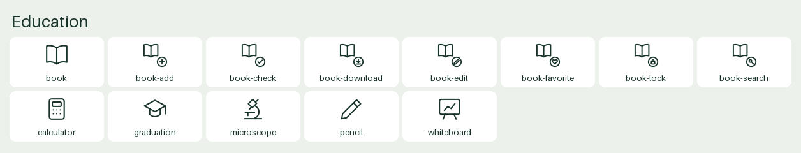

| Icon | SVG | PNG | Light PNG |
| --- | --- | --- | --- |
| `book` | [SVG](assets/svg/education/book.svg) | [PNG](assets/png/education/book.png) | [PNG](assets/png-light/education/book.png) |
| `book-add` | [SVG](assets/svg/education/book-add.svg) | [PNG](assets/png/education/book-add.png) | [PNG](assets/png-light/education/book-add.png) |
| `book-check` | [SVG](assets/svg/education/book-check.svg) | [PNG](assets/png/education/book-check.png) | [PNG](assets/png-light/education/book-check.png) |
| `book-download` | [SVG](assets/svg/education/book-download.svg) | [PNG](assets/png/education/book-download.png) | [PNG](assets/png-light/education/book-download.png) |
| `book-edit` | [SVG](assets/svg/education/book-edit.svg) | [PNG](assets/png/education/book-edit.png) | [PNG](assets/png-light/education/book-edit.png) |
| `book-favorite` | [SVG](assets/svg/education/book-favorite.svg) | [PNG](assets/png/education/book-favorite.png) | [PNG](assets/png-light/education/book-favorite.png) |
| `book-lock` | [SVG](assets/svg/education/book-lock.svg) | [PNG](assets/png/education/book-lock.png) | [PNG](assets/png-light/education/book-lock.png) |
| `book-search` | [SVG](assets/svg/education/book-search.svg) | [PNG](assets/png/education/book-search.png) | [PNG](assets/png-light/education/book-search.png) |
| `calculator` | [SVG](assets/svg/education/calculator.svg) | [PNG](assets/png/education/calculator.png) | [PNG](assets/png-light/education/calculator.png) |
| `graduation` | [SVG](assets/svg/education/graduation.svg) | [PNG](assets/png/education/graduation.png) | [PNG](assets/png-light/education/graduation.png) |
| `microscope` | [SVG](assets/svg/education/microscope.svg) | [PNG](assets/png/education/microscope.png) | [PNG](assets/png-light/education/microscope.png) |
| `pencil` | [SVG](assets/svg/education/pencil.svg) | [PNG](assets/png/education/pencil.png) | [PNG](assets/png-light/education/pencil.png) |
| `whiteboard` | [SVG](assets/svg/education/whiteboard.svg) | [PNG](assets/png/education/whiteboard.png) | [PNG](assets/png-light/education/whiteboard.png) |

## Files

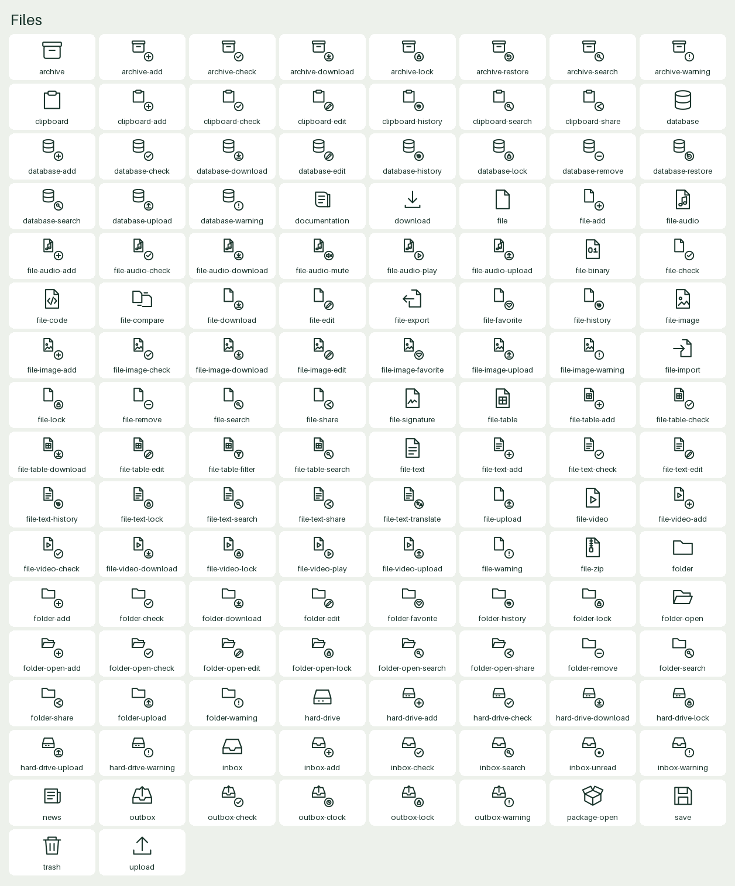

| Icon | SVG | PNG | Light PNG |
| --- | --- | --- | --- |
| `archive` | [SVG](assets/svg/files/archive.svg) | [PNG](assets/png/files/archive.png) | [PNG](assets/png-light/files/archive.png) |
| `archive-add` | [SVG](assets/svg/files/archive-add.svg) | [PNG](assets/png/files/archive-add.png) | [PNG](assets/png-light/files/archive-add.png) |
| `archive-check` | [SVG](assets/svg/files/archive-check.svg) | [PNG](assets/png/files/archive-check.png) | [PNG](assets/png-light/files/archive-check.png) |
| `archive-download` | [SVG](assets/svg/files/archive-download.svg) | [PNG](assets/png/files/archive-download.png) | [PNG](assets/png-light/files/archive-download.png) |
| `archive-lock` | [SVG](assets/svg/files/archive-lock.svg) | [PNG](assets/png/files/archive-lock.png) | [PNG](assets/png-light/files/archive-lock.png) |
| `archive-restore` | [SVG](assets/svg/files/archive-restore.svg) | [PNG](assets/png/files/archive-restore.png) | [PNG](assets/png-light/files/archive-restore.png) |
| `archive-search` | [SVG](assets/svg/files/archive-search.svg) | [PNG](assets/png/files/archive-search.png) | [PNG](assets/png-light/files/archive-search.png) |
| `archive-warning` | [SVG](assets/svg/files/archive-warning.svg) | [PNG](assets/png/files/archive-warning.png) | [PNG](assets/png-light/files/archive-warning.png) |
| `clipboard` | [SVG](assets/svg/files/clipboard.svg) | [PNG](assets/png/files/clipboard.png) | [PNG](assets/png-light/files/clipboard.png) |
| `clipboard-add` | [SVG](assets/svg/files/clipboard-add.svg) | [PNG](assets/png/files/clipboard-add.png) | [PNG](assets/png-light/files/clipboard-add.png) |
| `clipboard-check` | [SVG](assets/svg/files/clipboard-check.svg) | [PNG](assets/png/files/clipboard-check.png) | [PNG](assets/png-light/files/clipboard-check.png) |
| `clipboard-edit` | [SVG](assets/svg/files/clipboard-edit.svg) | [PNG](assets/png/files/clipboard-edit.png) | [PNG](assets/png-light/files/clipboard-edit.png) |
| `clipboard-history` | [SVG](assets/svg/files/clipboard-history.svg) | [PNG](assets/png/files/clipboard-history.png) | [PNG](assets/png-light/files/clipboard-history.png) |
| `clipboard-search` | [SVG](assets/svg/files/clipboard-search.svg) | [PNG](assets/png/files/clipboard-search.png) | [PNG](assets/png-light/files/clipboard-search.png) |
| `clipboard-share` | [SVG](assets/svg/files/clipboard-share.svg) | [PNG](assets/png/files/clipboard-share.png) | [PNG](assets/png-light/files/clipboard-share.png) |
| `database` | [SVG](assets/svg/files/database.svg) | [PNG](assets/png/files/database.png) | [PNG](assets/png-light/files/database.png) |
| `database-add` | [SVG](assets/svg/files/database-add.svg) | [PNG](assets/png/files/database-add.png) | [PNG](assets/png-light/files/database-add.png) |
| `database-check` | [SVG](assets/svg/files/database-check.svg) | [PNG](assets/png/files/database-check.png) | [PNG](assets/png-light/files/database-check.png) |
| `database-download` | [SVG](assets/svg/files/database-download.svg) | [PNG](assets/png/files/database-download.png) | [PNG](assets/png-light/files/database-download.png) |
| `database-edit` | [SVG](assets/svg/files/database-edit.svg) | [PNG](assets/png/files/database-edit.png) | [PNG](assets/png-light/files/database-edit.png) |
| `database-history` | [SVG](assets/svg/files/database-history.svg) | [PNG](assets/png/files/database-history.png) | [PNG](assets/png-light/files/database-history.png) |
| `database-lock` | [SVG](assets/svg/files/database-lock.svg) | [PNG](assets/png/files/database-lock.png) | [PNG](assets/png-light/files/database-lock.png) |
| `database-remove` | [SVG](assets/svg/files/database-remove.svg) | [PNG](assets/png/files/database-remove.png) | [PNG](assets/png-light/files/database-remove.png) |
| `database-restore` | [SVG](assets/svg/files/database-restore.svg) | [PNG](assets/png/files/database-restore.png) | [PNG](assets/png-light/files/database-restore.png) |
| `database-search` | [SVG](assets/svg/files/database-search.svg) | [PNG](assets/png/files/database-search.png) | [PNG](assets/png-light/files/database-search.png) |
| `database-upload` | [SVG](assets/svg/files/database-upload.svg) | [PNG](assets/png/files/database-upload.png) | [PNG](assets/png-light/files/database-upload.png) |
| `database-warning` | [SVG](assets/svg/files/database-warning.svg) | [PNG](assets/png/files/database-warning.png) | [PNG](assets/png-light/files/database-warning.png) |
| `documentation` | [SVG](assets/svg/files/documentation.svg) | [PNG](assets/png/files/documentation.png) | [PNG](assets/png-light/files/documentation.png) |
| `download` | [SVG](assets/svg/files/download.svg) | [PNG](assets/png/files/download.png) | [PNG](assets/png-light/files/download.png) |
| `file` | [SVG](assets/svg/files/file.svg) | [PNG](assets/png/files/file.png) | [PNG](assets/png-light/files/file.png) |
| `file-add` | [SVG](assets/svg/files/file-add.svg) | [PNG](assets/png/files/file-add.png) | [PNG](assets/png-light/files/file-add.png) |
| `file-audio` | [SVG](assets/svg/files/file-audio.svg) | [PNG](assets/png/files/file-audio.png) | [PNG](assets/png-light/files/file-audio.png) |
| `file-audio-add` | [SVG](assets/svg/files/file-audio-add.svg) | [PNG](assets/png/files/file-audio-add.png) | [PNG](assets/png-light/files/file-audio-add.png) |
| `file-audio-check` | [SVG](assets/svg/files/file-audio-check.svg) | [PNG](assets/png/files/file-audio-check.png) | [PNG](assets/png-light/files/file-audio-check.png) |
| `file-audio-download` | [SVG](assets/svg/files/file-audio-download.svg) | [PNG](assets/png/files/file-audio-download.png) | [PNG](assets/png-light/files/file-audio-download.png) |
| `file-audio-mute` | [SVG](assets/svg/files/file-audio-mute.svg) | [PNG](assets/png/files/file-audio-mute.png) | [PNG](assets/png-light/files/file-audio-mute.png) |
| `file-audio-play` | [SVG](assets/svg/files/file-audio-play.svg) | [PNG](assets/png/files/file-audio-play.png) | [PNG](assets/png-light/files/file-audio-play.png) |
| `file-audio-upload` | [SVG](assets/svg/files/file-audio-upload.svg) | [PNG](assets/png/files/file-audio-upload.png) | [PNG](assets/png-light/files/file-audio-upload.png) |
| `file-binary` | [SVG](assets/svg/files/file-binary.svg) | [PNG](assets/png/files/file-binary.png) | [PNG](assets/png-light/files/file-binary.png) |
| `file-check` | [SVG](assets/svg/files/file-check.svg) | [PNG](assets/png/files/file-check.png) | [PNG](assets/png-light/files/file-check.png) |
| `file-code` | [SVG](assets/svg/files/file-code.svg) | [PNG](assets/png/files/file-code.png) | [PNG](assets/png-light/files/file-code.png) |
| `file-compare` | [SVG](assets/svg/files/file-compare.svg) | [PNG](assets/png/files/file-compare.png) | [PNG](assets/png-light/files/file-compare.png) |
| `file-download` | [SVG](assets/svg/files/file-download.svg) | [PNG](assets/png/files/file-download.png) | [PNG](assets/png-light/files/file-download.png) |
| `file-edit` | [SVG](assets/svg/files/file-edit.svg) | [PNG](assets/png/files/file-edit.png) | [PNG](assets/png-light/files/file-edit.png) |
| `file-export` | [SVG](assets/svg/files/file-export.svg) | [PNG](assets/png/files/file-export.png) | [PNG](assets/png-light/files/file-export.png) |
| `file-favorite` | [SVG](assets/svg/files/file-favorite.svg) | [PNG](assets/png/files/file-favorite.png) | [PNG](assets/png-light/files/file-favorite.png) |
| `file-history` | [SVG](assets/svg/files/file-history.svg) | [PNG](assets/png/files/file-history.png) | [PNG](assets/png-light/files/file-history.png) |
| `file-image` | [SVG](assets/svg/files/file-image.svg) | [PNG](assets/png/files/file-image.png) | [PNG](assets/png-light/files/file-image.png) |
| `file-image-add` | [SVG](assets/svg/files/file-image-add.svg) | [PNG](assets/png/files/file-image-add.png) | [PNG](assets/png-light/files/file-image-add.png) |
| `file-image-check` | [SVG](assets/svg/files/file-image-check.svg) | [PNG](assets/png/files/file-image-check.png) | [PNG](assets/png-light/files/file-image-check.png) |
| `file-image-download` | [SVG](assets/svg/files/file-image-download.svg) | [PNG](assets/png/files/file-image-download.png) | [PNG](assets/png-light/files/file-image-download.png) |
| `file-image-edit` | [SVG](assets/svg/files/file-image-edit.svg) | [PNG](assets/png/files/file-image-edit.png) | [PNG](assets/png-light/files/file-image-edit.png) |
| `file-image-favorite` | [SVG](assets/svg/files/file-image-favorite.svg) | [PNG](assets/png/files/file-image-favorite.png) | [PNG](assets/png-light/files/file-image-favorite.png) |
| `file-image-upload` | [SVG](assets/svg/files/file-image-upload.svg) | [PNG](assets/png/files/file-image-upload.png) | [PNG](assets/png-light/files/file-image-upload.png) |
| `file-image-warning` | [SVG](assets/svg/files/file-image-warning.svg) | [PNG](assets/png/files/file-image-warning.png) | [PNG](assets/png-light/files/file-image-warning.png) |
| `file-import` | [SVG](assets/svg/files/file-import.svg) | [PNG](assets/png/files/file-import.png) | [PNG](assets/png-light/files/file-import.png) |
| `file-lock` | [SVG](assets/svg/files/file-lock.svg) | [PNG](assets/png/files/file-lock.png) | [PNG](assets/png-light/files/file-lock.png) |
| `file-remove` | [SVG](assets/svg/files/file-remove.svg) | [PNG](assets/png/files/file-remove.png) | [PNG](assets/png-light/files/file-remove.png) |
| `file-search` | [SVG](assets/svg/files/file-search.svg) | [PNG](assets/png/files/file-search.png) | [PNG](assets/png-light/files/file-search.png) |
| `file-share` | [SVG](assets/svg/files/file-share.svg) | [PNG](assets/png/files/file-share.png) | [PNG](assets/png-light/files/file-share.png) |
| `file-signature` | [SVG](assets/svg/files/file-signature.svg) | [PNG](assets/png/files/file-signature.png) | [PNG](assets/png-light/files/file-signature.png) |
| `file-table` | [SVG](assets/svg/files/file-table.svg) | [PNG](assets/png/files/file-table.png) | [PNG](assets/png-light/files/file-table.png) |
| `file-table-add` | [SVG](assets/svg/files/file-table-add.svg) | [PNG](assets/png/files/file-table-add.png) | [PNG](assets/png-light/files/file-table-add.png) |
| `file-table-check` | [SVG](assets/svg/files/file-table-check.svg) | [PNG](assets/png/files/file-table-check.png) | [PNG](assets/png-light/files/file-table-check.png) |
| `file-table-download` | [SVG](assets/svg/files/file-table-download.svg) | [PNG](assets/png/files/file-table-download.png) | [PNG](assets/png-light/files/file-table-download.png) |
| `file-table-edit` | [SVG](assets/svg/files/file-table-edit.svg) | [PNG](assets/png/files/file-table-edit.png) | [PNG](assets/png-light/files/file-table-edit.png) |
| `file-table-filter` | [SVG](assets/svg/files/file-table-filter.svg) | [PNG](assets/png/files/file-table-filter.png) | [PNG](assets/png-light/files/file-table-filter.png) |
| `file-table-search` | [SVG](assets/svg/files/file-table-search.svg) | [PNG](assets/png/files/file-table-search.png) | [PNG](assets/png-light/files/file-table-search.png) |
| `file-text` | [SVG](assets/svg/files/file-text.svg) | [PNG](assets/png/files/file-text.png) | [PNG](assets/png-light/files/file-text.png) |
| `file-text-add` | [SVG](assets/svg/files/file-text-add.svg) | [PNG](assets/png/files/file-text-add.png) | [PNG](assets/png-light/files/file-text-add.png) |
| `file-text-check` | [SVG](assets/svg/files/file-text-check.svg) | [PNG](assets/png/files/file-text-check.png) | [PNG](assets/png-light/files/file-text-check.png) |
| `file-text-edit` | [SVG](assets/svg/files/file-text-edit.svg) | [PNG](assets/png/files/file-text-edit.png) | [PNG](assets/png-light/files/file-text-edit.png) |
| `file-text-history` | [SVG](assets/svg/files/file-text-history.svg) | [PNG](assets/png/files/file-text-history.png) | [PNG](assets/png-light/files/file-text-history.png) |
| `file-text-lock` | [SVG](assets/svg/files/file-text-lock.svg) | [PNG](assets/png/files/file-text-lock.png) | [PNG](assets/png-light/files/file-text-lock.png) |
| `file-text-search` | [SVG](assets/svg/files/file-text-search.svg) | [PNG](assets/png/files/file-text-search.png) | [PNG](assets/png-light/files/file-text-search.png) |
| `file-text-share` | [SVG](assets/svg/files/file-text-share.svg) | [PNG](assets/png/files/file-text-share.png) | [PNG](assets/png-light/files/file-text-share.png) |
| `file-text-translate` | [SVG](assets/svg/files/file-text-translate.svg) | [PNG](assets/png/files/file-text-translate.png) | [PNG](assets/png-light/files/file-text-translate.png) |
| `file-upload` | [SVG](assets/svg/files/file-upload.svg) | [PNG](assets/png/files/file-upload.png) | [PNG](assets/png-light/files/file-upload.png) |
| `file-video` | [SVG](assets/svg/files/file-video.svg) | [PNG](assets/png/files/file-video.png) | [PNG](assets/png-light/files/file-video.png) |
| `file-video-add` | [SVG](assets/svg/files/file-video-add.svg) | [PNG](assets/png/files/file-video-add.png) | [PNG](assets/png-light/files/file-video-add.png) |
| `file-video-check` | [SVG](assets/svg/files/file-video-check.svg) | [PNG](assets/png/files/file-video-check.png) | [PNG](assets/png-light/files/file-video-check.png) |
| `file-video-download` | [SVG](assets/svg/files/file-video-download.svg) | [PNG](assets/png/files/file-video-download.png) | [PNG](assets/png-light/files/file-video-download.png) |
| `file-video-lock` | [SVG](assets/svg/files/file-video-lock.svg) | [PNG](assets/png/files/file-video-lock.png) | [PNG](assets/png-light/files/file-video-lock.png) |
| `file-video-play` | [SVG](assets/svg/files/file-video-play.svg) | [PNG](assets/png/files/file-video-play.png) | [PNG](assets/png-light/files/file-video-play.png) |
| `file-video-upload` | [SVG](assets/svg/files/file-video-upload.svg) | [PNG](assets/png/files/file-video-upload.png) | [PNG](assets/png-light/files/file-video-upload.png) |
| `file-warning` | [SVG](assets/svg/files/file-warning.svg) | [PNG](assets/png/files/file-warning.png) | [PNG](assets/png-light/files/file-warning.png) |
| `file-zip` | [SVG](assets/svg/files/file-zip.svg) | [PNG](assets/png/files/file-zip.png) | [PNG](assets/png-light/files/file-zip.png) |
| `folder` | [SVG](assets/svg/files/folder.svg) | [PNG](assets/png/files/folder.png) | [PNG](assets/png-light/files/folder.png) |
| `folder-add` | [SVG](assets/svg/files/folder-add.svg) | [PNG](assets/png/files/folder-add.png) | [PNG](assets/png-light/files/folder-add.png) |
| `folder-check` | [SVG](assets/svg/files/folder-check.svg) | [PNG](assets/png/files/folder-check.png) | [PNG](assets/png-light/files/folder-check.png) |
| `folder-download` | [SVG](assets/svg/files/folder-download.svg) | [PNG](assets/png/files/folder-download.png) | [PNG](assets/png-light/files/folder-download.png) |
| `folder-edit` | [SVG](assets/svg/files/folder-edit.svg) | [PNG](assets/png/files/folder-edit.png) | [PNG](assets/png-light/files/folder-edit.png) |
| `folder-favorite` | [SVG](assets/svg/files/folder-favorite.svg) | [PNG](assets/png/files/folder-favorite.png) | [PNG](assets/png-light/files/folder-favorite.png) |
| `folder-history` | [SVG](assets/svg/files/folder-history.svg) | [PNG](assets/png/files/folder-history.png) | [PNG](assets/png-light/files/folder-history.png) |
| `folder-lock` | [SVG](assets/svg/files/folder-lock.svg) | [PNG](assets/png/files/folder-lock.png) | [PNG](assets/png-light/files/folder-lock.png) |
| `folder-open` | [SVG](assets/svg/files/folder-open.svg) | [PNG](assets/png/files/folder-open.png) | [PNG](assets/png-light/files/folder-open.png) |
| `folder-open-add` | [SVG](assets/svg/files/folder-open-add.svg) | [PNG](assets/png/files/folder-open-add.png) | [PNG](assets/png-light/files/folder-open-add.png) |
| `folder-open-check` | [SVG](assets/svg/files/folder-open-check.svg) | [PNG](assets/png/files/folder-open-check.png) | [PNG](assets/png-light/files/folder-open-check.png) |
| `folder-open-edit` | [SVG](assets/svg/files/folder-open-edit.svg) | [PNG](assets/png/files/folder-open-edit.png) | [PNG](assets/png-light/files/folder-open-edit.png) |
| `folder-open-lock` | [SVG](assets/svg/files/folder-open-lock.svg) | [PNG](assets/png/files/folder-open-lock.png) | [PNG](assets/png-light/files/folder-open-lock.png) |
| `folder-open-search` | [SVG](assets/svg/files/folder-open-search.svg) | [PNG](assets/png/files/folder-open-search.png) | [PNG](assets/png-light/files/folder-open-search.png) |
| `folder-open-share` | [SVG](assets/svg/files/folder-open-share.svg) | [PNG](assets/png/files/folder-open-share.png) | [PNG](assets/png-light/files/folder-open-share.png) |
| `folder-remove` | [SVG](assets/svg/files/folder-remove.svg) | [PNG](assets/png/files/folder-remove.png) | [PNG](assets/png-light/files/folder-remove.png) |
| `folder-search` | [SVG](assets/svg/files/folder-search.svg) | [PNG](assets/png/files/folder-search.png) | [PNG](assets/png-light/files/folder-search.png) |
| `folder-share` | [SVG](assets/svg/files/folder-share.svg) | [PNG](assets/png/files/folder-share.png) | [PNG](assets/png-light/files/folder-share.png) |
| `folder-upload` | [SVG](assets/svg/files/folder-upload.svg) | [PNG](assets/png/files/folder-upload.png) | [PNG](assets/png-light/files/folder-upload.png) |
| `folder-warning` | [SVG](assets/svg/files/folder-warning.svg) | [PNG](assets/png/files/folder-warning.png) | [PNG](assets/png-light/files/folder-warning.png) |
| `hard-drive` | [SVG](assets/svg/files/hard-drive.svg) | [PNG](assets/png/files/hard-drive.png) | [PNG](assets/png-light/files/hard-drive.png) |
| `hard-drive-add` | [SVG](assets/svg/files/hard-drive-add.svg) | [PNG](assets/png/files/hard-drive-add.png) | [PNG](assets/png-light/files/hard-drive-add.png) |
| `hard-drive-check` | [SVG](assets/svg/files/hard-drive-check.svg) | [PNG](assets/png/files/hard-drive-check.png) | [PNG](assets/png-light/files/hard-drive-check.png) |
| `hard-drive-download` | [SVG](assets/svg/files/hard-drive-download.svg) | [PNG](assets/png/files/hard-drive-download.png) | [PNG](assets/png-light/files/hard-drive-download.png) |
| `hard-drive-lock` | [SVG](assets/svg/files/hard-drive-lock.svg) | [PNG](assets/png/files/hard-drive-lock.png) | [PNG](assets/png-light/files/hard-drive-lock.png) |
| `hard-drive-upload` | [SVG](assets/svg/files/hard-drive-upload.svg) | [PNG](assets/png/files/hard-drive-upload.png) | [PNG](assets/png-light/files/hard-drive-upload.png) |
| `hard-drive-warning` | [SVG](assets/svg/files/hard-drive-warning.svg) | [PNG](assets/png/files/hard-drive-warning.png) | [PNG](assets/png-light/files/hard-drive-warning.png) |
| `inbox` | [SVG](assets/svg/files/inbox.svg) | [PNG](assets/png/files/inbox.png) | [PNG](assets/png-light/files/inbox.png) |
| `inbox-add` | [SVG](assets/svg/files/inbox-add.svg) | [PNG](assets/png/files/inbox-add.png) | [PNG](assets/png-light/files/inbox-add.png) |
| `inbox-check` | [SVG](assets/svg/files/inbox-check.svg) | [PNG](assets/png/files/inbox-check.png) | [PNG](assets/png-light/files/inbox-check.png) |
| `inbox-search` | [SVG](assets/svg/files/inbox-search.svg) | [PNG](assets/png/files/inbox-search.png) | [PNG](assets/png-light/files/inbox-search.png) |
| `inbox-unread` | [SVG](assets/svg/files/inbox-unread.svg) | [PNG](assets/png/files/inbox-unread.png) | [PNG](assets/png-light/files/inbox-unread.png) |
| `inbox-warning` | [SVG](assets/svg/files/inbox-warning.svg) | [PNG](assets/png/files/inbox-warning.png) | [PNG](assets/png-light/files/inbox-warning.png) |
| `news` | [SVG](assets/svg/files/news.svg) | [PNG](assets/png/files/news.png) | [PNG](assets/png-light/files/news.png) |
| `outbox` | [SVG](assets/svg/files/outbox.svg) | [PNG](assets/png/files/outbox.png) | [PNG](assets/png-light/files/outbox.png) |
| `outbox-check` | [SVG](assets/svg/files/outbox-check.svg) | [PNG](assets/png/files/outbox-check.png) | [PNG](assets/png-light/files/outbox-check.png) |
| `outbox-clock` | [SVG](assets/svg/files/outbox-clock.svg) | [PNG](assets/png/files/outbox-clock.png) | [PNG](assets/png-light/files/outbox-clock.png) |
| `outbox-lock` | [SVG](assets/svg/files/outbox-lock.svg) | [PNG](assets/png/files/outbox-lock.png) | [PNG](assets/png-light/files/outbox-lock.png) |
| `outbox-warning` | [SVG](assets/svg/files/outbox-warning.svg) | [PNG](assets/png/files/outbox-warning.png) | [PNG](assets/png-light/files/outbox-warning.png) |
| `package-open` | [SVG](assets/svg/files/package-open.svg) | [PNG](assets/png/files/package-open.png) | [PNG](assets/png-light/files/package-open.png) |
| `save` | [SVG](assets/svg/files/save.svg) | [PNG](assets/png/files/save.png) | [PNG](assets/png-light/files/save.png) |
| `trash` | [SVG](assets/svg/files/trash.svg) | [PNG](assets/png/files/trash.png) | [PNG](assets/png-light/files/trash.png) |
| `upload` | [SVG](assets/svg/files/upload.svg) | [PNG](assets/png/files/upload.png) | [PNG](assets/png-light/files/upload.png) |

## Gaming

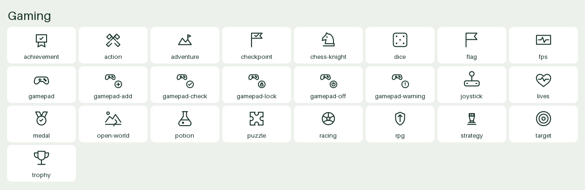

| Icon | SVG | PNG | Light PNG |
| --- | --- | --- | --- |
| `achievement` | [SVG](assets/svg/gaming/achievement.svg) | [PNG](assets/png/gaming/achievement.png) | [PNG](assets/png-light/gaming/achievement.png) |
| `action` | [SVG](assets/svg/gaming/action.svg) | [PNG](assets/png/gaming/action.png) | [PNG](assets/png-light/gaming/action.png) |
| `adventure` | [SVG](assets/svg/gaming/adventure.svg) | [PNG](assets/png/gaming/adventure.png) | [PNG](assets/png-light/gaming/adventure.png) |
| `checkpoint` | [SVG](assets/svg/gaming/checkpoint.svg) | [PNG](assets/png/gaming/checkpoint.png) | [PNG](assets/png-light/gaming/checkpoint.png) |
| `chess-knight` | [SVG](assets/svg/gaming/chess-knight.svg) | [PNG](assets/png/gaming/chess-knight.png) | [PNG](assets/png-light/gaming/chess-knight.png) |
| `dice` | [SVG](assets/svg/gaming/dice.svg) | [PNG](assets/png/gaming/dice.png) | [PNG](assets/png-light/gaming/dice.png) |
| `flag` | [SVG](assets/svg/gaming/flag.svg) | [PNG](assets/png/gaming/flag.png) | [PNG](assets/png-light/gaming/flag.png) |
| `fps` | [SVG](assets/svg/gaming/fps.svg) | [PNG](assets/png/gaming/fps.png) | [PNG](assets/png-light/gaming/fps.png) |
| `gamepad` | [SVG](assets/svg/gaming/gamepad.svg) | [PNG](assets/png/gaming/gamepad.png) | [PNG](assets/png-light/gaming/gamepad.png) |
| `gamepad-add` | [SVG](assets/svg/gaming/gamepad-add.svg) | [PNG](assets/png/gaming/gamepad-add.png) | [PNG](assets/png-light/gaming/gamepad-add.png) |
| `gamepad-check` | [SVG](assets/svg/gaming/gamepad-check.svg) | [PNG](assets/png/gaming/gamepad-check.png) | [PNG](assets/png-light/gaming/gamepad-check.png) |
| `gamepad-lock` | [SVG](assets/svg/gaming/gamepad-lock.svg) | [PNG](assets/png/gaming/gamepad-lock.png) | [PNG](assets/png-light/gaming/gamepad-lock.png) |
| `gamepad-off` | [SVG](assets/svg/gaming/gamepad-off.svg) | [PNG](assets/png/gaming/gamepad-off.png) | [PNG](assets/png-light/gaming/gamepad-off.png) |
| `gamepad-warning` | [SVG](assets/svg/gaming/gamepad-warning.svg) | [PNG](assets/png/gaming/gamepad-warning.png) | [PNG](assets/png-light/gaming/gamepad-warning.png) |
| `joystick` | [SVG](assets/svg/gaming/joystick.svg) | [PNG](assets/png/gaming/joystick.png) | [PNG](assets/png-light/gaming/joystick.png) |
| `lives` | [SVG](assets/svg/gaming/lives.svg) | [PNG](assets/png/gaming/lives.png) | [PNG](assets/png-light/gaming/lives.png) |
| `medal` | [SVG](assets/svg/gaming/medal.svg) | [PNG](assets/png/gaming/medal.png) | [PNG](assets/png-light/gaming/medal.png) |
| `open-world` | [SVG](assets/svg/gaming/open-world.svg) | [PNG](assets/png/gaming/open-world.png) | [PNG](assets/png-light/gaming/open-world.png) |
| `potion` | [SVG](assets/svg/gaming/potion.svg) | [PNG](assets/png/gaming/potion.png) | [PNG](assets/png-light/gaming/potion.png) |
| `puzzle` | [SVG](assets/svg/gaming/puzzle.svg) | [PNG](assets/png/gaming/puzzle.png) | [PNG](assets/png-light/gaming/puzzle.png) |
| `racing` | [SVG](assets/svg/gaming/racing.svg) | [PNG](assets/png/gaming/racing.png) | [PNG](assets/png-light/gaming/racing.png) |
| `rpg` | [SVG](assets/svg/gaming/rpg.svg) | [PNG](assets/png/gaming/rpg.png) | [PNG](assets/png-light/gaming/rpg.png) |
| `strategy` | [SVG](assets/svg/gaming/strategy.svg) | [PNG](assets/png/gaming/strategy.png) | [PNG](assets/png-light/gaming/strategy.png) |
| `target` | [SVG](assets/svg/gaming/target.svg) | [PNG](assets/png/gaming/target.png) | [PNG](assets/png-light/gaming/target.png) |
| `trophy` | [SVG](assets/svg/gaming/trophy.svg) | [PNG](assets/png/gaming/trophy.png) | [PNG](assets/png-light/gaming/trophy.png) |

## Interface

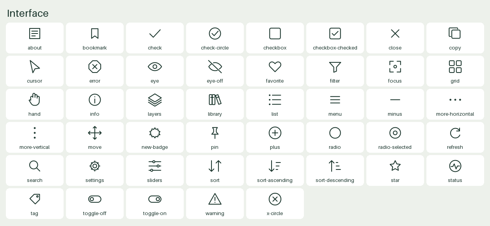

| Icon | SVG | PNG | Light PNG |
| --- | --- | --- | --- |
| `about` | [SVG](assets/svg/interface/about.svg) | [PNG](assets/png/interface/about.png) | [PNG](assets/png-light/interface/about.png) |
| `bookmark` | [SVG](assets/svg/interface/bookmark.svg) | [PNG](assets/png/interface/bookmark.png) | [PNG](assets/png-light/interface/bookmark.png) |
| `check` | [SVG](assets/svg/interface/check.svg) | [PNG](assets/png/interface/check.png) | [PNG](assets/png-light/interface/check.png) |
| `check-circle` | [SVG](assets/svg/interface/check-circle.svg) | [PNG](assets/png/interface/check-circle.png) | [PNG](assets/png-light/interface/check-circle.png) |
| `checkbox` | [SVG](assets/svg/interface/checkbox.svg) | [PNG](assets/png/interface/checkbox.png) | [PNG](assets/png-light/interface/checkbox.png) |
| `checkbox-checked` | [SVG](assets/svg/interface/checkbox-checked.svg) | [PNG](assets/png/interface/checkbox-checked.png) | [PNG](assets/png-light/interface/checkbox-checked.png) |
| `close` | [SVG](assets/svg/interface/close.svg) | [PNG](assets/png/interface/close.png) | [PNG](assets/png-light/interface/close.png) |
| `copy` | [SVG](assets/svg/interface/copy.svg) | [PNG](assets/png/interface/copy.png) | [PNG](assets/png-light/interface/copy.png) |
| `cursor` | [SVG](assets/svg/interface/cursor.svg) | [PNG](assets/png/interface/cursor.png) | [PNG](assets/png-light/interface/cursor.png) |
| `error` | [SVG](assets/svg/interface/error.svg) | [PNG](assets/png/interface/error.png) | [PNG](assets/png-light/interface/error.png) |
| `eye` | [SVG](assets/svg/interface/eye.svg) | [PNG](assets/png/interface/eye.png) | [PNG](assets/png-light/interface/eye.png) |
| `eye-off` | [SVG](assets/svg/interface/eye-off.svg) | [PNG](assets/png/interface/eye-off.png) | [PNG](assets/png-light/interface/eye-off.png) |
| `favorite` | [SVG](assets/svg/interface/favorite.svg) | [PNG](assets/png/interface/favorite.png) | [PNG](assets/png-light/interface/favorite.png) |
| `filter` | [SVG](assets/svg/interface/filter.svg) | [PNG](assets/png/interface/filter.png) | [PNG](assets/png-light/interface/filter.png) |
| `focus` | [SVG](assets/svg/interface/focus.svg) | [PNG](assets/png/interface/focus.png) | [PNG](assets/png-light/interface/focus.png) |
| `grid` | [SVG](assets/svg/interface/grid.svg) | [PNG](assets/png/interface/grid.png) | [PNG](assets/png-light/interface/grid.png) |
| `hand` | [SVG](assets/svg/interface/hand.svg) | [PNG](assets/png/interface/hand.png) | [PNG](assets/png-light/interface/hand.png) |
| `info` | [SVG](assets/svg/interface/info.svg) | [PNG](assets/png/interface/info.png) | [PNG](assets/png-light/interface/info.png) |
| `layers` | [SVG](assets/svg/interface/layers.svg) | [PNG](assets/png/interface/layers.png) | [PNG](assets/png-light/interface/layers.png) |
| `library` | [SVG](assets/svg/interface/library.svg) | [PNG](assets/png/interface/library.png) | [PNG](assets/png-light/interface/library.png) |
| `list` | [SVG](assets/svg/interface/list.svg) | [PNG](assets/png/interface/list.png) | [PNG](assets/png-light/interface/list.png) |
| `menu` | [SVG](assets/svg/interface/menu.svg) | [PNG](assets/png/interface/menu.png) | [PNG](assets/png-light/interface/menu.png) |
| `minus` | [SVG](assets/svg/interface/minus.svg) | [PNG](assets/png/interface/minus.png) | [PNG](assets/png-light/interface/minus.png) |
| `more-horizontal` | [SVG](assets/svg/interface/more-horizontal.svg) | [PNG](assets/png/interface/more-horizontal.png) | [PNG](assets/png-light/interface/more-horizontal.png) |
| `more-vertical` | [SVG](assets/svg/interface/more-vertical.svg) | [PNG](assets/png/interface/more-vertical.png) | [PNG](assets/png-light/interface/more-vertical.png) |
| `move` | [SVG](assets/svg/interface/move.svg) | [PNG](assets/png/interface/move.png) | [PNG](assets/png-light/interface/move.png) |
| `new-badge` | [SVG](assets/svg/interface/new-badge.svg) | [PNG](assets/png/interface/new-badge.png) | [PNG](assets/png-light/interface/new-badge.png) |
| `pin` | [SVG](assets/svg/interface/pin.svg) | [PNG](assets/png/interface/pin.png) | [PNG](assets/png-light/interface/pin.png) |
| `plus` | [SVG](assets/svg/interface/plus.svg) | [PNG](assets/png/interface/plus.png) | [PNG](assets/png-light/interface/plus.png) |
| `radio` | [SVG](assets/svg/interface/radio.svg) | [PNG](assets/png/interface/radio.png) | [PNG](assets/png-light/interface/radio.png) |
| `radio-selected` | [SVG](assets/svg/interface/radio-selected.svg) | [PNG](assets/png/interface/radio-selected.png) | [PNG](assets/png-light/interface/radio-selected.png) |
| `refresh` | [SVG](assets/svg/interface/refresh.svg) | [PNG](assets/png/interface/refresh.png) | [PNG](assets/png-light/interface/refresh.png) |
| `search` | [SVG](assets/svg/interface/search.svg) | [PNG](assets/png/interface/search.png) | [PNG](assets/png-light/interface/search.png) |
| `settings` | [SVG](assets/svg/interface/settings.svg) | [PNG](assets/png/interface/settings.png) | [PNG](assets/png-light/interface/settings.png) |
| `sliders` | [SVG](assets/svg/interface/sliders.svg) | [PNG](assets/png/interface/sliders.png) | [PNG](assets/png-light/interface/sliders.png) |
| `sort` | [SVG](assets/svg/interface/sort.svg) | [PNG](assets/png/interface/sort.png) | [PNG](assets/png-light/interface/sort.png) |
| `sort-ascending` | [SVG](assets/svg/interface/sort-ascending.svg) | [PNG](assets/png/interface/sort-ascending.png) | [PNG](assets/png-light/interface/sort-ascending.png) |
| `sort-descending` | [SVG](assets/svg/interface/sort-descending.svg) | [PNG](assets/png/interface/sort-descending.png) | [PNG](assets/png-light/interface/sort-descending.png) |
| `star` | [SVG](assets/svg/interface/star.svg) | [PNG](assets/png/interface/star.png) | [PNG](assets/png-light/interface/star.png) |
| `status` | [SVG](assets/svg/interface/status.svg) | [PNG](assets/png/interface/status.png) | [PNG](assets/png-light/interface/status.png) |
| `tag` | [SVG](assets/svg/interface/tag.svg) | [PNG](assets/png/interface/tag.png) | [PNG](assets/png-light/interface/tag.png) |
| `toggle-off` | [SVG](assets/svg/interface/toggle-off.svg) | [PNG](assets/png/interface/toggle-off.png) | [PNG](assets/png-light/interface/toggle-off.png) |
| `toggle-on` | [SVG](assets/svg/interface/toggle-on.svg) | [PNG](assets/png/interface/toggle-on.png) | [PNG](assets/png-light/interface/toggle-on.png) |
| `warning` | [SVG](assets/svg/interface/warning.svg) | [PNG](assets/png/interface/warning.png) | [PNG](assets/png-light/interface/warning.png) |
| `x-circle` | [SVG](assets/svg/interface/x-circle.svg) | [PNG](assets/png/interface/x-circle.png) | [PNG](assets/png-light/interface/x-circle.png) |

## Media

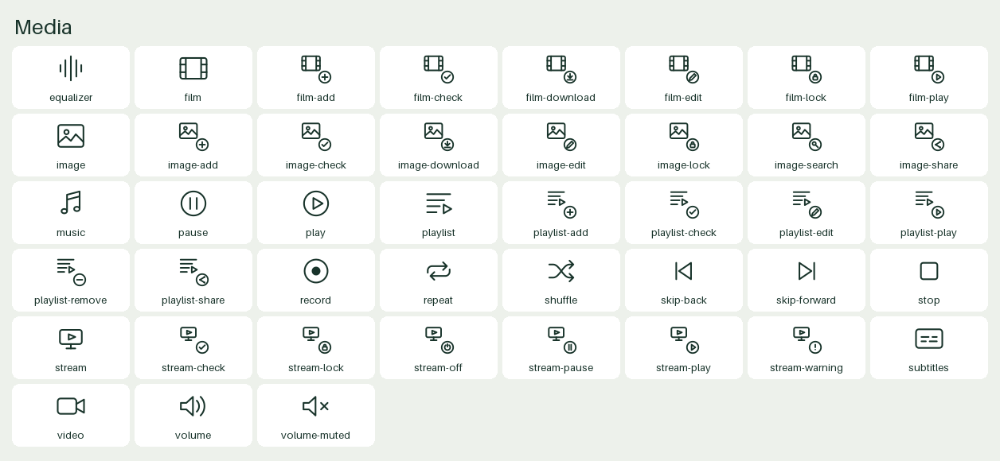

| Icon | SVG | PNG | Light PNG |
| --- | --- | --- | --- |
| `equalizer` | [SVG](assets/svg/media/equalizer.svg) | [PNG](assets/png/media/equalizer.png) | [PNG](assets/png-light/media/equalizer.png) |
| `film` | [SVG](assets/svg/media/film.svg) | [PNG](assets/png/media/film.png) | [PNG](assets/png-light/media/film.png) |
| `film-add` | [SVG](assets/svg/media/film-add.svg) | [PNG](assets/png/media/film-add.png) | [PNG](assets/png-light/media/film-add.png) |
| `film-check` | [SVG](assets/svg/media/film-check.svg) | [PNG](assets/png/media/film-check.png) | [PNG](assets/png-light/media/film-check.png) |
| `film-download` | [SVG](assets/svg/media/film-download.svg) | [PNG](assets/png/media/film-download.png) | [PNG](assets/png-light/media/film-download.png) |
| `film-edit` | [SVG](assets/svg/media/film-edit.svg) | [PNG](assets/png/media/film-edit.png) | [PNG](assets/png-light/media/film-edit.png) |
| `film-lock` | [SVG](assets/svg/media/film-lock.svg) | [PNG](assets/png/media/film-lock.png) | [PNG](assets/png-light/media/film-lock.png) |
| `film-play` | [SVG](assets/svg/media/film-play.svg) | [PNG](assets/png/media/film-play.png) | [PNG](assets/png-light/media/film-play.png) |
| `image` | [SVG](assets/svg/media/image.svg) | [PNG](assets/png/media/image.png) | [PNG](assets/png-light/media/image.png) |
| `image-add` | [SVG](assets/svg/media/image-add.svg) | [PNG](assets/png/media/image-add.png) | [PNG](assets/png-light/media/image-add.png) |
| `image-check` | [SVG](assets/svg/media/image-check.svg) | [PNG](assets/png/media/image-check.png) | [PNG](assets/png-light/media/image-check.png) |
| `image-download` | [SVG](assets/svg/media/image-download.svg) | [PNG](assets/png/media/image-download.png) | [PNG](assets/png-light/media/image-download.png) |
| `image-edit` | [SVG](assets/svg/media/image-edit.svg) | [PNG](assets/png/media/image-edit.png) | [PNG](assets/png-light/media/image-edit.png) |
| `image-lock` | [SVG](assets/svg/media/image-lock.svg) | [PNG](assets/png/media/image-lock.png) | [PNG](assets/png-light/media/image-lock.png) |
| `image-search` | [SVG](assets/svg/media/image-search.svg) | [PNG](assets/png/media/image-search.png) | [PNG](assets/png-light/media/image-search.png) |
| `image-share` | [SVG](assets/svg/media/image-share.svg) | [PNG](assets/png/media/image-share.png) | [PNG](assets/png-light/media/image-share.png) |
| `music` | [SVG](assets/svg/media/music.svg) | [PNG](assets/png/media/music.png) | [PNG](assets/png-light/media/music.png) |
| `pause` | [SVG](assets/svg/media/pause.svg) | [PNG](assets/png/media/pause.png) | [PNG](assets/png-light/media/pause.png) |
| `play` | [SVG](assets/svg/media/play.svg) | [PNG](assets/png/media/play.png) | [PNG](assets/png-light/media/play.png) |
| `playlist` | [SVG](assets/svg/media/playlist.svg) | [PNG](assets/png/media/playlist.png) | [PNG](assets/png-light/media/playlist.png) |
| `playlist-add` | [SVG](assets/svg/media/playlist-add.svg) | [PNG](assets/png/media/playlist-add.png) | [PNG](assets/png-light/media/playlist-add.png) |
| `playlist-check` | [SVG](assets/svg/media/playlist-check.svg) | [PNG](assets/png/media/playlist-check.png) | [PNG](assets/png-light/media/playlist-check.png) |
| `playlist-edit` | [SVG](assets/svg/media/playlist-edit.svg) | [PNG](assets/png/media/playlist-edit.png) | [PNG](assets/png-light/media/playlist-edit.png) |
| `playlist-play` | [SVG](assets/svg/media/playlist-play.svg) | [PNG](assets/png/media/playlist-play.png) | [PNG](assets/png-light/media/playlist-play.png) |
| `playlist-remove` | [SVG](assets/svg/media/playlist-remove.svg) | [PNG](assets/png/media/playlist-remove.png) | [PNG](assets/png-light/media/playlist-remove.png) |
| `playlist-share` | [SVG](assets/svg/media/playlist-share.svg) | [PNG](assets/png/media/playlist-share.png) | [PNG](assets/png-light/media/playlist-share.png) |
| `record` | [SVG](assets/svg/media/record.svg) | [PNG](assets/png/media/record.png) | [PNG](assets/png-light/media/record.png) |
| `repeat` | [SVG](assets/svg/media/repeat.svg) | [PNG](assets/png/media/repeat.png) | [PNG](assets/png-light/media/repeat.png) |
| `shuffle` | [SVG](assets/svg/media/shuffle.svg) | [PNG](assets/png/media/shuffle.png) | [PNG](assets/png-light/media/shuffle.png) |
| `skip-back` | [SVG](assets/svg/media/skip-back.svg) | [PNG](assets/png/media/skip-back.png) | [PNG](assets/png-light/media/skip-back.png) |
| `skip-forward` | [SVG](assets/svg/media/skip-forward.svg) | [PNG](assets/png/media/skip-forward.png) | [PNG](assets/png-light/media/skip-forward.png) |
| `stop` | [SVG](assets/svg/media/stop.svg) | [PNG](assets/png/media/stop.png) | [PNG](assets/png-light/media/stop.png) |
| `stream` | [SVG](assets/svg/media/stream.svg) | [PNG](assets/png/media/stream.png) | [PNG](assets/png-light/media/stream.png) |
| `stream-check` | [SVG](assets/svg/media/stream-check.svg) | [PNG](assets/png/media/stream-check.png) | [PNG](assets/png-light/media/stream-check.png) |
| `stream-lock` | [SVG](assets/svg/media/stream-lock.svg) | [PNG](assets/png/media/stream-lock.png) | [PNG](assets/png-light/media/stream-lock.png) |
| `stream-off` | [SVG](assets/svg/media/stream-off.svg) | [PNG](assets/png/media/stream-off.png) | [PNG](assets/png-light/media/stream-off.png) |
| `stream-pause` | [SVG](assets/svg/media/stream-pause.svg) | [PNG](assets/png/media/stream-pause.png) | [PNG](assets/png-light/media/stream-pause.png) |
| `stream-play` | [SVG](assets/svg/media/stream-play.svg) | [PNG](assets/png/media/stream-play.png) | [PNG](assets/png-light/media/stream-play.png) |
| `stream-warning` | [SVG](assets/svg/media/stream-warning.svg) | [PNG](assets/png/media/stream-warning.png) | [PNG](assets/png-light/media/stream-warning.png) |
| `subtitles` | [SVG](assets/svg/media/subtitles.svg) | [PNG](assets/png/media/subtitles.png) | [PNG](assets/png-light/media/subtitles.png) |
| `video` | [SVG](assets/svg/media/video.svg) | [PNG](assets/png/media/video.png) | [PNG](assets/png-light/media/video.png) |
| `volume` | [SVG](assets/svg/media/volume.svg) | [PNG](assets/png/media/volume.png) | [PNG](assets/png-light/media/volume.png) |
| `volume-muted` | [SVG](assets/svg/media/volume-muted.svg) | [PNG](assets/png/media/volume-muted.png) | [PNG](assets/png-light/media/volume-muted.png) |

## Nature

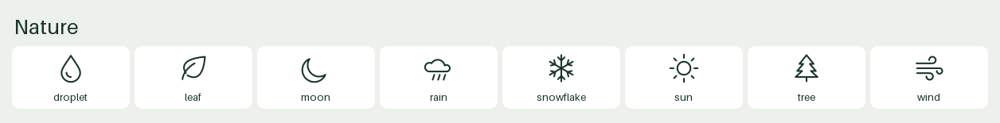

| Icon | SVG | PNG | Light PNG |
| --- | --- | --- | --- |
| `droplet` | [SVG](assets/svg/nature/droplet.svg) | [PNG](assets/png/nature/droplet.png) | [PNG](assets/png-light/nature/droplet.png) |
| `leaf` | [SVG](assets/svg/nature/leaf.svg) | [PNG](assets/png/nature/leaf.png) | [PNG](assets/png-light/nature/leaf.png) |
| `moon` | [SVG](assets/svg/nature/moon.svg) | [PNG](assets/png/nature/moon.png) | [PNG](assets/png-light/nature/moon.png) |
| `rain` | [SVG](assets/svg/nature/rain.svg) | [PNG](assets/png/nature/rain.png) | [PNG](assets/png-light/nature/rain.png) |
| `snowflake` | [SVG](assets/svg/nature/snowflake.svg) | [PNG](assets/png/nature/snowflake.png) | [PNG](assets/png-light/nature/snowflake.png) |
| `sun` | [SVG](assets/svg/nature/sun.svg) | [PNG](assets/png/nature/sun.png) | [PNG](assets/png-light/nature/sun.png) |
| `tree` | [SVG](assets/svg/nature/tree.svg) | [PNG](assets/png/nature/tree.png) | [PNG](assets/png-light/nature/tree.png) |
| `wind` | [SVG](assets/svg/nature/wind.svg) | [PNG](assets/png/nature/wind.png) | [PNG](assets/png-light/nature/wind.png) |

## Navigation

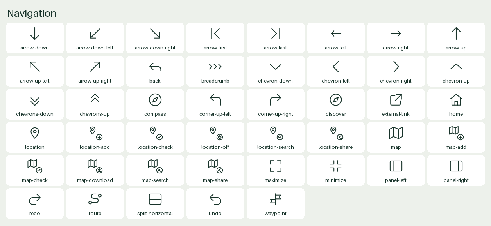

| Icon | SVG | PNG | Light PNG |
| --- | --- | --- | --- |
| `arrow-down` | [SVG](assets/svg/navigation/arrow-down.svg) | [PNG](assets/png/navigation/arrow-down.png) | [PNG](assets/png-light/navigation/arrow-down.png) |
| `arrow-down-left` | [SVG](assets/svg/navigation/arrow-down-left.svg) | [PNG](assets/png/navigation/arrow-down-left.png) | [PNG](assets/png-light/navigation/arrow-down-left.png) |
| `arrow-down-right` | [SVG](assets/svg/navigation/arrow-down-right.svg) | [PNG](assets/png/navigation/arrow-down-right.png) | [PNG](assets/png-light/navigation/arrow-down-right.png) |
| `arrow-first` | [SVG](assets/svg/navigation/arrow-first.svg) | [PNG](assets/png/navigation/arrow-first.png) | [PNG](assets/png-light/navigation/arrow-first.png) |
| `arrow-last` | [SVG](assets/svg/navigation/arrow-last.svg) | [PNG](assets/png/navigation/arrow-last.png) | [PNG](assets/png-light/navigation/arrow-last.png) |
| `arrow-left` | [SVG](assets/svg/navigation/arrow-left.svg) | [PNG](assets/png/navigation/arrow-left.png) | [PNG](assets/png-light/navigation/arrow-left.png) |
| `arrow-right` | [SVG](assets/svg/navigation/arrow-right.svg) | [PNG](assets/png/navigation/arrow-right.png) | [PNG](assets/png-light/navigation/arrow-right.png) |
| `arrow-up` | [SVG](assets/svg/navigation/arrow-up.svg) | [PNG](assets/png/navigation/arrow-up.png) | [PNG](assets/png-light/navigation/arrow-up.png) |
| `arrow-up-left` | [SVG](assets/svg/navigation/arrow-up-left.svg) | [PNG](assets/png/navigation/arrow-up-left.png) | [PNG](assets/png-light/navigation/arrow-up-left.png) |
| `arrow-up-right` | [SVG](assets/svg/navigation/arrow-up-right.svg) | [PNG](assets/png/navigation/arrow-up-right.png) | [PNG](assets/png-light/navigation/arrow-up-right.png) |
| `back` | [SVG](assets/svg/navigation/back.svg) | [PNG](assets/png/navigation/back.png) | [PNG](assets/png-light/navigation/back.png) |
| `breadcrumb` | [SVG](assets/svg/navigation/breadcrumb.svg) | [PNG](assets/png/navigation/breadcrumb.png) | [PNG](assets/png-light/navigation/breadcrumb.png) |
| `chevron-down` | [SVG](assets/svg/navigation/chevron-down.svg) | [PNG](assets/png/navigation/chevron-down.png) | [PNG](assets/png-light/navigation/chevron-down.png) |
| `chevron-left` | [SVG](assets/svg/navigation/chevron-left.svg) | [PNG](assets/png/navigation/chevron-left.png) | [PNG](assets/png-light/navigation/chevron-left.png) |
| `chevron-right` | [SVG](assets/svg/navigation/chevron-right.svg) | [PNG](assets/png/navigation/chevron-right.png) | [PNG](assets/png-light/navigation/chevron-right.png) |
| `chevron-up` | [SVG](assets/svg/navigation/chevron-up.svg) | [PNG](assets/png/navigation/chevron-up.png) | [PNG](assets/png-light/navigation/chevron-up.png) |
| `chevrons-down` | [SVG](assets/svg/navigation/chevrons-down.svg) | [PNG](assets/png/navigation/chevrons-down.png) | [PNG](assets/png-light/navigation/chevrons-down.png) |
| `chevrons-up` | [SVG](assets/svg/navigation/chevrons-up.svg) | [PNG](assets/png/navigation/chevrons-up.png) | [PNG](assets/png-light/navigation/chevrons-up.png) |
| `compass` | [SVG](assets/svg/navigation/compass.svg) | [PNG](assets/png/navigation/compass.png) | [PNG](assets/png-light/navigation/compass.png) |
| `corner-up-left` | [SVG](assets/svg/navigation/corner-up-left.svg) | [PNG](assets/png/navigation/corner-up-left.png) | [PNG](assets/png-light/navigation/corner-up-left.png) |
| `corner-up-right` | [SVG](assets/svg/navigation/corner-up-right.svg) | [PNG](assets/png/navigation/corner-up-right.png) | [PNG](assets/png-light/navigation/corner-up-right.png) |
| `discover` | [SVG](assets/svg/navigation/discover.svg) | [PNG](assets/png/navigation/discover.png) | [PNG](assets/png-light/navigation/discover.png) |
| `external-link` | [SVG](assets/svg/navigation/external-link.svg) | [PNG](assets/png/navigation/external-link.png) | [PNG](assets/png-light/navigation/external-link.png) |
| `home` | [SVG](assets/svg/navigation/home.svg) | [PNG](assets/png/navigation/home.png) | [PNG](assets/png-light/navigation/home.png) |
| `location` | [SVG](assets/svg/navigation/location.svg) | [PNG](assets/png/navigation/location.png) | [PNG](assets/png-light/navigation/location.png) |
| `location-add` | [SVG](assets/svg/navigation/location-add.svg) | [PNG](assets/png/navigation/location-add.png) | [PNG](assets/png-light/navigation/location-add.png) |
| `location-check` | [SVG](assets/svg/navigation/location-check.svg) | [PNG](assets/png/navigation/location-check.png) | [PNG](assets/png-light/navigation/location-check.png) |
| `location-off` | [SVG](assets/svg/navigation/location-off.svg) | [PNG](assets/png/navigation/location-off.png) | [PNG](assets/png-light/navigation/location-off.png) |
| `location-search` | [SVG](assets/svg/navigation/location-search.svg) | [PNG](assets/png/navigation/location-search.png) | [PNG](assets/png-light/navigation/location-search.png) |
| `location-share` | [SVG](assets/svg/navigation/location-share.svg) | [PNG](assets/png/navigation/location-share.png) | [PNG](assets/png-light/navigation/location-share.png) |
| `map` | [SVG](assets/svg/navigation/map.svg) | [PNG](assets/png/navigation/map.png) | [PNG](assets/png-light/navigation/map.png) |
| `map-add` | [SVG](assets/svg/navigation/map-add.svg) | [PNG](assets/png/navigation/map-add.png) | [PNG](assets/png-light/navigation/map-add.png) |
| `map-check` | [SVG](assets/svg/navigation/map-check.svg) | [PNG](assets/png/navigation/map-check.png) | [PNG](assets/png-light/navigation/map-check.png) |
| `map-download` | [SVG](assets/svg/navigation/map-download.svg) | [PNG](assets/png/navigation/map-download.png) | [PNG](assets/png-light/navigation/map-download.png) |
| `map-search` | [SVG](assets/svg/navigation/map-search.svg) | [PNG](assets/png/navigation/map-search.png) | [PNG](assets/png-light/navigation/map-search.png) |
| `map-share` | [SVG](assets/svg/navigation/map-share.svg) | [PNG](assets/png/navigation/map-share.png) | [PNG](assets/png-light/navigation/map-share.png) |
| `maximize` | [SVG](assets/svg/navigation/maximize.svg) | [PNG](assets/png/navigation/maximize.png) | [PNG](assets/png-light/navigation/maximize.png) |
| `minimize` | [SVG](assets/svg/navigation/minimize.svg) | [PNG](assets/png/navigation/minimize.png) | [PNG](assets/png-light/navigation/minimize.png) |
| `panel-left` | [SVG](assets/svg/navigation/panel-left.svg) | [PNG](assets/png/navigation/panel-left.png) | [PNG](assets/png-light/navigation/panel-left.png) |
| `panel-right` | [SVG](assets/svg/navigation/panel-right.svg) | [PNG](assets/png/navigation/panel-right.png) | [PNG](assets/png-light/navigation/panel-right.png) |
| `redo` | [SVG](assets/svg/navigation/redo.svg) | [PNG](assets/png/navigation/redo.png) | [PNG](assets/png-light/navigation/redo.png) |
| `route` | [SVG](assets/svg/navigation/route.svg) | [PNG](assets/png/navigation/route.png) | [PNG](assets/png-light/navigation/route.png) |
| `split-horizontal` | [SVG](assets/svg/navigation/split-horizontal.svg) | [PNG](assets/png/navigation/split-horizontal.png) | [PNG](assets/png-light/navigation/split-horizontal.png) |
| `undo` | [SVG](assets/svg/navigation/undo.svg) | [PNG](assets/png/navigation/undo.png) | [PNG](assets/png-light/navigation/undo.png) |
| `waypoint` | [SVG](assets/svg/navigation/waypoint.svg) | [PNG](assets/png/navigation/waypoint.png) | [PNG](assets/png-light/navigation/waypoint.png) |

## Network

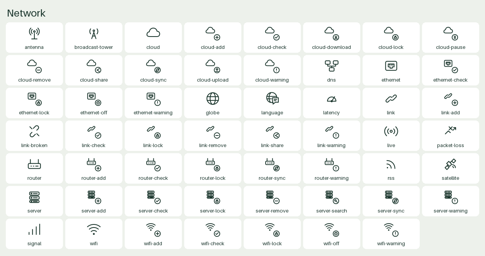

| Icon | SVG | PNG | Light PNG |
| --- | --- | --- | --- |
| `antenna` | [SVG](assets/svg/network/antenna.svg) | [PNG](assets/png/network/antenna.png) | [PNG](assets/png-light/network/antenna.png) |
| `broadcast-tower` | [SVG](assets/svg/network/broadcast-tower.svg) | [PNG](assets/png/network/broadcast-tower.png) | [PNG](assets/png-light/network/broadcast-tower.png) |
| `cloud` | [SVG](assets/svg/network/cloud.svg) | [PNG](assets/png/network/cloud.png) | [PNG](assets/png-light/network/cloud.png) |
| `cloud-add` | [SVG](assets/svg/network/cloud-add.svg) | [PNG](assets/png/network/cloud-add.png) | [PNG](assets/png-light/network/cloud-add.png) |
| `cloud-check` | [SVG](assets/svg/network/cloud-check.svg) | [PNG](assets/png/network/cloud-check.png) | [PNG](assets/png-light/network/cloud-check.png) |
| `cloud-download` | [SVG](assets/svg/network/cloud-download.svg) | [PNG](assets/png/network/cloud-download.png) | [PNG](assets/png-light/network/cloud-download.png) |
| `cloud-lock` | [SVG](assets/svg/network/cloud-lock.svg) | [PNG](assets/png/network/cloud-lock.png) | [PNG](assets/png-light/network/cloud-lock.png) |
| `cloud-pause` | [SVG](assets/svg/network/cloud-pause.svg) | [PNG](assets/png/network/cloud-pause.png) | [PNG](assets/png-light/network/cloud-pause.png) |
| `cloud-remove` | [SVG](assets/svg/network/cloud-remove.svg) | [PNG](assets/png/network/cloud-remove.png) | [PNG](assets/png-light/network/cloud-remove.png) |
| `cloud-share` | [SVG](assets/svg/network/cloud-share.svg) | [PNG](assets/png/network/cloud-share.png) | [PNG](assets/png-light/network/cloud-share.png) |
| `cloud-sync` | [SVG](assets/svg/network/cloud-sync.svg) | [PNG](assets/png/network/cloud-sync.png) | [PNG](assets/png-light/network/cloud-sync.png) |
| `cloud-upload` | [SVG](assets/svg/network/cloud-upload.svg) | [PNG](assets/png/network/cloud-upload.png) | [PNG](assets/png-light/network/cloud-upload.png) |
| `cloud-warning` | [SVG](assets/svg/network/cloud-warning.svg) | [PNG](assets/png/network/cloud-warning.png) | [PNG](assets/png-light/network/cloud-warning.png) |
| `dns` | [SVG](assets/svg/network/dns.svg) | [PNG](assets/png/network/dns.png) | [PNG](assets/png-light/network/dns.png) |
| `ethernet` | [SVG](assets/svg/network/ethernet.svg) | [PNG](assets/png/network/ethernet.png) | [PNG](assets/png-light/network/ethernet.png) |
| `ethernet-check` | [SVG](assets/svg/network/ethernet-check.svg) | [PNG](assets/png/network/ethernet-check.png) | [PNG](assets/png-light/network/ethernet-check.png) |
| `ethernet-lock` | [SVG](assets/svg/network/ethernet-lock.svg) | [PNG](assets/png/network/ethernet-lock.png) | [PNG](assets/png-light/network/ethernet-lock.png) |
| `ethernet-off` | [SVG](assets/svg/network/ethernet-off.svg) | [PNG](assets/png/network/ethernet-off.png) | [PNG](assets/png-light/network/ethernet-off.png) |
| `ethernet-warning` | [SVG](assets/svg/network/ethernet-warning.svg) | [PNG](assets/png/network/ethernet-warning.png) | [PNG](assets/png-light/network/ethernet-warning.png) |
| `globe` | [SVG](assets/svg/network/globe.svg) | [PNG](assets/png/network/globe.png) | [PNG](assets/png-light/network/globe.png) |
| `language` | [SVG](assets/svg/network/language.svg) | [PNG](assets/png/network/language.png) | [PNG](assets/png-light/network/language.png) |
| `latency` | [SVG](assets/svg/network/latency.svg) | [PNG](assets/png/network/latency.png) | [PNG](assets/png-light/network/latency.png) |
| `link` | [SVG](assets/svg/network/link.svg) | [PNG](assets/png/network/link.png) | [PNG](assets/png-light/network/link.png) |
| `link-add` | [SVG](assets/svg/network/link-add.svg) | [PNG](assets/png/network/link-add.png) | [PNG](assets/png-light/network/link-add.png) |
| `link-broken` | [SVG](assets/svg/network/link-broken.svg) | [PNG](assets/png/network/link-broken.png) | [PNG](assets/png-light/network/link-broken.png) |
| `link-check` | [SVG](assets/svg/network/link-check.svg) | [PNG](assets/png/network/link-check.png) | [PNG](assets/png-light/network/link-check.png) |
| `link-lock` | [SVG](assets/svg/network/link-lock.svg) | [PNG](assets/png/network/link-lock.png) | [PNG](assets/png-light/network/link-lock.png) |
| `link-remove` | [SVG](assets/svg/network/link-remove.svg) | [PNG](assets/png/network/link-remove.png) | [PNG](assets/png-light/network/link-remove.png) |
| `link-share` | [SVG](assets/svg/network/link-share.svg) | [PNG](assets/png/network/link-share.png) | [PNG](assets/png-light/network/link-share.png) |
| `link-warning` | [SVG](assets/svg/network/link-warning.svg) | [PNG](assets/png/network/link-warning.png) | [PNG](assets/png-light/network/link-warning.png) |
| `live` | [SVG](assets/svg/network/live.svg) | [PNG](assets/png/network/live.png) | [PNG](assets/png-light/network/live.png) |
| `packet-loss` | [SVG](assets/svg/network/packet-loss.svg) | [PNG](assets/png/network/packet-loss.png) | [PNG](assets/png-light/network/packet-loss.png) |
| `router` | [SVG](assets/svg/network/router.svg) | [PNG](assets/png/network/router.png) | [PNG](assets/png-light/network/router.png) |
| `router-add` | [SVG](assets/svg/network/router-add.svg) | [PNG](assets/png/network/router-add.png) | [PNG](assets/png-light/network/router-add.png) |
| `router-check` | [SVG](assets/svg/network/router-check.svg) | [PNG](assets/png/network/router-check.png) | [PNG](assets/png-light/network/router-check.png) |
| `router-lock` | [SVG](assets/svg/network/router-lock.svg) | [PNG](assets/png/network/router-lock.png) | [PNG](assets/png-light/network/router-lock.png) |
| `router-sync` | [SVG](assets/svg/network/router-sync.svg) | [PNG](assets/png/network/router-sync.png) | [PNG](assets/png-light/network/router-sync.png) |
| `router-warning` | [SVG](assets/svg/network/router-warning.svg) | [PNG](assets/png/network/router-warning.png) | [PNG](assets/png-light/network/router-warning.png) |
| `rss` | [SVG](assets/svg/network/rss.svg) | [PNG](assets/png/network/rss.png) | [PNG](assets/png-light/network/rss.png) |
| `satellite` | [SVG](assets/svg/network/satellite.svg) | [PNG](assets/png/network/satellite.png) | [PNG](assets/png-light/network/satellite.png) |
| `server` | [SVG](assets/svg/network/server.svg) | [PNG](assets/png/network/server.png) | [PNG](assets/png-light/network/server.png) |
| `server-add` | [SVG](assets/svg/network/server-add.svg) | [PNG](assets/png/network/server-add.png) | [PNG](assets/png-light/network/server-add.png) |
| `server-check` | [SVG](assets/svg/network/server-check.svg) | [PNG](assets/png/network/server-check.png) | [PNG](assets/png-light/network/server-check.png) |
| `server-lock` | [SVG](assets/svg/network/server-lock.svg) | [PNG](assets/png/network/server-lock.png) | [PNG](assets/png-light/network/server-lock.png) |
| `server-remove` | [SVG](assets/svg/network/server-remove.svg) | [PNG](assets/png/network/server-remove.png) | [PNG](assets/png-light/network/server-remove.png) |
| `server-search` | [SVG](assets/svg/network/server-search.svg) | [PNG](assets/png/network/server-search.png) | [PNG](assets/png-light/network/server-search.png) |
| `server-sync` | [SVG](assets/svg/network/server-sync.svg) | [PNG](assets/png/network/server-sync.png) | [PNG](assets/png-light/network/server-sync.png) |
| `server-warning` | [SVG](assets/svg/network/server-warning.svg) | [PNG](assets/png/network/server-warning.png) | [PNG](assets/png-light/network/server-warning.png) |
| `signal` | [SVG](assets/svg/network/signal.svg) | [PNG](assets/png/network/signal.png) | [PNG](assets/png-light/network/signal.png) |
| `wifi` | [SVG](assets/svg/network/wifi.svg) | [PNG](assets/png/network/wifi.png) | [PNG](assets/png-light/network/wifi.png) |
| `wifi-add` | [SVG](assets/svg/network/wifi-add.svg) | [PNG](assets/png/network/wifi-add.png) | [PNG](assets/png-light/network/wifi-add.png) |
| `wifi-check` | [SVG](assets/svg/network/wifi-check.svg) | [PNG](assets/png/network/wifi-check.png) | [PNG](assets/png-light/network/wifi-check.png) |
| `wifi-lock` | [SVG](assets/svg/network/wifi-lock.svg) | [PNG](assets/png/network/wifi-lock.png) | [PNG](assets/png-light/network/wifi-lock.png) |
| `wifi-off` | [SVG](assets/svg/network/wifi-off.svg) | [PNG](assets/png/network/wifi-off.png) | [PNG](assets/png-light/network/wifi-off.png) |
| `wifi-warning` | [SVG](assets/svg/network/wifi-warning.svg) | [PNG](assets/png/network/wifi-warning.png) | [PNG](assets/png-light/network/wifi-warning.png) |

## People

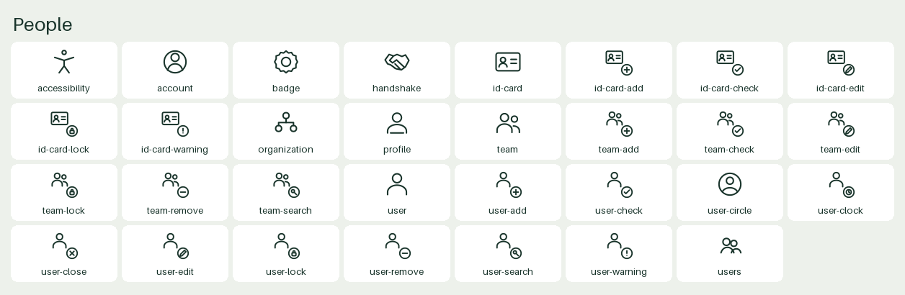

| Icon | SVG | PNG | Light PNG |
| --- | --- | --- | --- |
| `accessibility` | [SVG](assets/svg/people/accessibility.svg) | [PNG](assets/png/people/accessibility.png) | [PNG](assets/png-light/people/accessibility.png) |
| `account` | [SVG](assets/svg/people/account.svg) | [PNG](assets/png/people/account.png) | [PNG](assets/png-light/people/account.png) |
| `badge` | [SVG](assets/svg/people/badge.svg) | [PNG](assets/png/people/badge.png) | [PNG](assets/png-light/people/badge.png) |
| `handshake` | [SVG](assets/svg/people/handshake.svg) | [PNG](assets/png/people/handshake.png) | [PNG](assets/png-light/people/handshake.png) |
| `id-card` | [SVG](assets/svg/people/id-card.svg) | [PNG](assets/png/people/id-card.png) | [PNG](assets/png-light/people/id-card.png) |
| `id-card-add` | [SVG](assets/svg/people/id-card-add.svg) | [PNG](assets/png/people/id-card-add.png) | [PNG](assets/png-light/people/id-card-add.png) |
| `id-card-check` | [SVG](assets/svg/people/id-card-check.svg) | [PNG](assets/png/people/id-card-check.png) | [PNG](assets/png-light/people/id-card-check.png) |
| `id-card-edit` | [SVG](assets/svg/people/id-card-edit.svg) | [PNG](assets/png/people/id-card-edit.png) | [PNG](assets/png-light/people/id-card-edit.png) |
| `id-card-lock` | [SVG](assets/svg/people/id-card-lock.svg) | [PNG](assets/png/people/id-card-lock.png) | [PNG](assets/png-light/people/id-card-lock.png) |
| `id-card-warning` | [SVG](assets/svg/people/id-card-warning.svg) | [PNG](assets/png/people/id-card-warning.png) | [PNG](assets/png-light/people/id-card-warning.png) |
| `organization` | [SVG](assets/svg/people/organization.svg) | [PNG](assets/png/people/organization.png) | [PNG](assets/png-light/people/organization.png) |
| `profile` | [SVG](assets/svg/people/profile.svg) | [PNG](assets/png/people/profile.png) | [PNG](assets/png-light/people/profile.png) |
| `team` | [SVG](assets/svg/people/team.svg) | [PNG](assets/png/people/team.png) | [PNG](assets/png-light/people/team.png) |
| `team-add` | [SVG](assets/svg/people/team-add.svg) | [PNG](assets/png/people/team-add.png) | [PNG](assets/png-light/people/team-add.png) |
| `team-check` | [SVG](assets/svg/people/team-check.svg) | [PNG](assets/png/people/team-check.png) | [PNG](assets/png-light/people/team-check.png) |
| `team-edit` | [SVG](assets/svg/people/team-edit.svg) | [PNG](assets/png/people/team-edit.png) | [PNG](assets/png-light/people/team-edit.png) |
| `team-lock` | [SVG](assets/svg/people/team-lock.svg) | [PNG](assets/png/people/team-lock.png) | [PNG](assets/png-light/people/team-lock.png) |
| `team-remove` | [SVG](assets/svg/people/team-remove.svg) | [PNG](assets/png/people/team-remove.png) | [PNG](assets/png-light/people/team-remove.png) |
| `team-search` | [SVG](assets/svg/people/team-search.svg) | [PNG](assets/png/people/team-search.png) | [PNG](assets/png-light/people/team-search.png) |
| `user` | [SVG](assets/svg/people/user.svg) | [PNG](assets/png/people/user.png) | [PNG](assets/png-light/people/user.png) |
| `user-add` | [SVG](assets/svg/people/user-add.svg) | [PNG](assets/png/people/user-add.png) | [PNG](assets/png-light/people/user-add.png) |
| `user-check` | [SVG](assets/svg/people/user-check.svg) | [PNG](assets/png/people/user-check.png) | [PNG](assets/png-light/people/user-check.png) |
| `user-circle` | [SVG](assets/svg/people/user-circle.svg) | [PNG](assets/png/people/user-circle.png) | [PNG](assets/png-light/people/user-circle.png) |
| `user-clock` | [SVG](assets/svg/people/user-clock.svg) | [PNG](assets/png/people/user-clock.png) | [PNG](assets/png-light/people/user-clock.png) |
| `user-close` | [SVG](assets/svg/people/user-close.svg) | [PNG](assets/png/people/user-close.png) | [PNG](assets/png-light/people/user-close.png) |
| `user-edit` | [SVG](assets/svg/people/user-edit.svg) | [PNG](assets/png/people/user-edit.png) | [PNG](assets/png-light/people/user-edit.png) |
| `user-lock` | [SVG](assets/svg/people/user-lock.svg) | [PNG](assets/png/people/user-lock.png) | [PNG](assets/png-light/people/user-lock.png) |
| `user-remove` | [SVG](assets/svg/people/user-remove.svg) | [PNG](assets/png/people/user-remove.png) | [PNG](assets/png-light/people/user-remove.png) |
| `user-search` | [SVG](assets/svg/people/user-search.svg) | [PNG](assets/png/people/user-search.png) | [PNG](assets/png-light/people/user-search.png) |
| `user-warning` | [SVG](assets/svg/people/user-warning.svg) | [PNG](assets/png/people/user-warning.png) | [PNG](assets/png-light/people/user-warning.png) |
| `users` | [SVG](assets/svg/people/users.svg) | [PNG](assets/png/people/users.png) | [PNG](assets/png-light/people/users.png) |

## Security

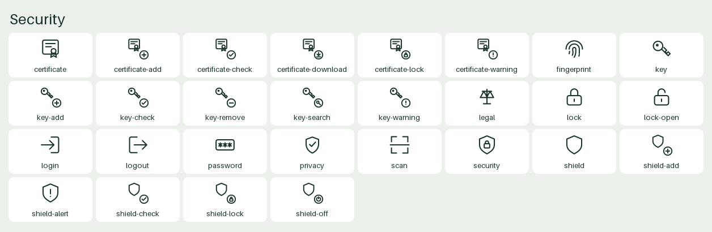

| Icon | SVG | PNG | Light PNG |
| --- | --- | --- | --- |
| `certificate` | [SVG](assets/svg/security/certificate.svg) | [PNG](assets/png/security/certificate.png) | [PNG](assets/png-light/security/certificate.png) |
| `certificate-add` | [SVG](assets/svg/security/certificate-add.svg) | [PNG](assets/png/security/certificate-add.png) | [PNG](assets/png-light/security/certificate-add.png) |
| `certificate-check` | [SVG](assets/svg/security/certificate-check.svg) | [PNG](assets/png/security/certificate-check.png) | [PNG](assets/png-light/security/certificate-check.png) |
| `certificate-download` | [SVG](assets/svg/security/certificate-download.svg) | [PNG](assets/png/security/certificate-download.png) | [PNG](assets/png-light/security/certificate-download.png) |
| `certificate-lock` | [SVG](assets/svg/security/certificate-lock.svg) | [PNG](assets/png/security/certificate-lock.png) | [PNG](assets/png-light/security/certificate-lock.png) |
| `certificate-warning` | [SVG](assets/svg/security/certificate-warning.svg) | [PNG](assets/png/security/certificate-warning.png) | [PNG](assets/png-light/security/certificate-warning.png) |
| `fingerprint` | [SVG](assets/svg/security/fingerprint.svg) | [PNG](assets/png/security/fingerprint.png) | [PNG](assets/png-light/security/fingerprint.png) |
| `key` | [SVG](assets/svg/security/key.svg) | [PNG](assets/png/security/key.png) | [PNG](assets/png-light/security/key.png) |
| `key-add` | [SVG](assets/svg/security/key-add.svg) | [PNG](assets/png/security/key-add.png) | [PNG](assets/png-light/security/key-add.png) |
| `key-check` | [SVG](assets/svg/security/key-check.svg) | [PNG](assets/png/security/key-check.png) | [PNG](assets/png-light/security/key-check.png) |
| `key-remove` | [SVG](assets/svg/security/key-remove.svg) | [PNG](assets/png/security/key-remove.png) | [PNG](assets/png-light/security/key-remove.png) |
| `key-search` | [SVG](assets/svg/security/key-search.svg) | [PNG](assets/png/security/key-search.png) | [PNG](assets/png-light/security/key-search.png) |
| `key-warning` | [SVG](assets/svg/security/key-warning.svg) | [PNG](assets/png/security/key-warning.png) | [PNG](assets/png-light/security/key-warning.png) |
| `legal` | [SVG](assets/svg/security/legal.svg) | [PNG](assets/png/security/legal.png) | [PNG](assets/png-light/security/legal.png) |
| `lock` | [SVG](assets/svg/security/lock.svg) | [PNG](assets/png/security/lock.png) | [PNG](assets/png-light/security/lock.png) |
| `lock-open` | [SVG](assets/svg/security/lock-open.svg) | [PNG](assets/png/security/lock-open.png) | [PNG](assets/png-light/security/lock-open.png) |
| `login` | [SVG](assets/svg/security/login.svg) | [PNG](assets/png/security/login.png) | [PNG](assets/png-light/security/login.png) |
| `logout` | [SVG](assets/svg/security/logout.svg) | [PNG](assets/png/security/logout.png) | [PNG](assets/png-light/security/logout.png) |
| `password` | [SVG](assets/svg/security/password.svg) | [PNG](assets/png/security/password.png) | [PNG](assets/png-light/security/password.png) |
| `privacy` | [SVG](assets/svg/security/privacy.svg) | [PNG](assets/png/security/privacy.png) | [PNG](assets/png-light/security/privacy.png) |
| `scan` | [SVG](assets/svg/security/scan.svg) | [PNG](assets/png/security/scan.png) | [PNG](assets/png-light/security/scan.png) |
| `security` | [SVG](assets/svg/security/security.svg) | [PNG](assets/png/security/security.png) | [PNG](assets/png-light/security/security.png) |
| `shield` | [SVG](assets/svg/security/shield.svg) | [PNG](assets/png/security/shield.png) | [PNG](assets/png-light/security/shield.png) |
| `shield-add` | [SVG](assets/svg/security/shield-add.svg) | [PNG](assets/png/security/shield-add.png) | [PNG](assets/png-light/security/shield-add.png) |
| `shield-alert` | [SVG](assets/svg/security/shield-alert.svg) | [PNG](assets/png/security/shield-alert.png) | [PNG](assets/png-light/security/shield-alert.png) |
| `shield-check` | [SVG](assets/svg/security/shield-check.svg) | [PNG](assets/png/security/shield-check.png) | [PNG](assets/png-light/security/shield-check.png) |
| `shield-lock` | [SVG](assets/svg/security/shield-lock.svg) | [PNG](assets/png/security/shield-lock.png) | [PNG](assets/png-light/security/shield-lock.png) |
| `shield-off` | [SVG](assets/svg/security/shield-off.svg) | [PNG](assets/png/security/shield-off.png) | [PNG](assets/png-light/security/shield-off.png) |

## Time

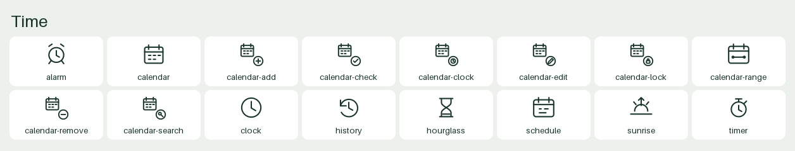

| Icon | SVG | PNG | Light PNG |
| --- | --- | --- | --- |
| `alarm` | [SVG](assets/svg/time/alarm.svg) | [PNG](assets/png/time/alarm.png) | [PNG](assets/png-light/time/alarm.png) |
| `calendar` | [SVG](assets/svg/time/calendar.svg) | [PNG](assets/png/time/calendar.png) | [PNG](assets/png-light/time/calendar.png) |
| `calendar-add` | [SVG](assets/svg/time/calendar-add.svg) | [PNG](assets/png/time/calendar-add.png) | [PNG](assets/png-light/time/calendar-add.png) |
| `calendar-check` | [SVG](assets/svg/time/calendar-check.svg) | [PNG](assets/png/time/calendar-check.png) | [PNG](assets/png-light/time/calendar-check.png) |
| `calendar-clock` | [SVG](assets/svg/time/calendar-clock.svg) | [PNG](assets/png/time/calendar-clock.png) | [PNG](assets/png-light/time/calendar-clock.png) |
| `calendar-edit` | [SVG](assets/svg/time/calendar-edit.svg) | [PNG](assets/png/time/calendar-edit.png) | [PNG](assets/png-light/time/calendar-edit.png) |
| `calendar-lock` | [SVG](assets/svg/time/calendar-lock.svg) | [PNG](assets/png/time/calendar-lock.png) | [PNG](assets/png-light/time/calendar-lock.png) |
| `calendar-range` | [SVG](assets/svg/time/calendar-range.svg) | [PNG](assets/png/time/calendar-range.png) | [PNG](assets/png-light/time/calendar-range.png) |
| `calendar-remove` | [SVG](assets/svg/time/calendar-remove.svg) | [PNG](assets/png/time/calendar-remove.png) | [PNG](assets/png-light/time/calendar-remove.png) |
| `calendar-search` | [SVG](assets/svg/time/calendar-search.svg) | [PNG](assets/png/time/calendar-search.png) | [PNG](assets/png-light/time/calendar-search.png) |
| `clock` | [SVG](assets/svg/time/clock.svg) | [PNG](assets/png/time/clock.png) | [PNG](assets/png-light/time/clock.png) |
| `history` | [SVG](assets/svg/time/history.svg) | [PNG](assets/png/time/history.png) | [PNG](assets/png-light/time/history.png) |
| `hourglass` | [SVG](assets/svg/time/hourglass.svg) | [PNG](assets/png/time/hourglass.png) | [PNG](assets/png-light/time/hourglass.png) |
| `schedule` | [SVG](assets/svg/time/schedule.svg) | [PNG](assets/png/time/schedule.png) | [PNG](assets/png-light/time/schedule.png) |
| `sunrise` | [SVG](assets/svg/time/sunrise.svg) | [PNG](assets/png/time/sunrise.png) | [PNG](assets/png-light/time/sunrise.png) |
| `timer` | [SVG](assets/svg/time/timer.svg) | [PNG](assets/png/time/timer.png) | [PNG](assets/png-light/time/timer.png) |

## Travel

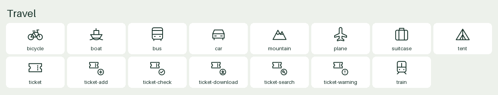

| Icon | SVG | PNG | Light PNG |
| --- | --- | --- | --- |
| `bicycle` | [SVG](assets/svg/travel/bicycle.svg) | [PNG](assets/png/travel/bicycle.png) | [PNG](assets/png-light/travel/bicycle.png) |
| `boat` | [SVG](assets/svg/travel/boat.svg) | [PNG](assets/png/travel/boat.png) | [PNG](assets/png-light/travel/boat.png) |
| `bus` | [SVG](assets/svg/travel/bus.svg) | [PNG](assets/png/travel/bus.png) | [PNG](assets/png-light/travel/bus.png) |
| `car` | [SVG](assets/svg/travel/car.svg) | [PNG](assets/png/travel/car.png) | [PNG](assets/png-light/travel/car.png) |
| `mountain` | [SVG](assets/svg/travel/mountain.svg) | [PNG](assets/png/travel/mountain.png) | [PNG](assets/png-light/travel/mountain.png) |
| `plane` | [SVG](assets/svg/travel/plane.svg) | [PNG](assets/png/travel/plane.png) | [PNG](assets/png-light/travel/plane.png) |
| `suitcase` | [SVG](assets/svg/travel/suitcase.svg) | [PNG](assets/png/travel/suitcase.png) | [PNG](assets/png-light/travel/suitcase.png) |
| `tent` | [SVG](assets/svg/travel/tent.svg) | [PNG](assets/png/travel/tent.png) | [PNG](assets/png-light/travel/tent.png) |
| `ticket` | [SVG](assets/svg/travel/ticket.svg) | [PNG](assets/png/travel/ticket.png) | [PNG](assets/png-light/travel/ticket.png) |
| `ticket-add` | [SVG](assets/svg/travel/ticket-add.svg) | [PNG](assets/png/travel/ticket-add.png) | [PNG](assets/png-light/travel/ticket-add.png) |
| `ticket-check` | [SVG](assets/svg/travel/ticket-check.svg) | [PNG](assets/png/travel/ticket-check.png) | [PNG](assets/png-light/travel/ticket-check.png) |
| `ticket-download` | [SVG](assets/svg/travel/ticket-download.svg) | [PNG](assets/png/travel/ticket-download.png) | [PNG](assets/png-light/travel/ticket-download.png) |
| `ticket-search` | [SVG](assets/svg/travel/ticket-search.svg) | [PNG](assets/png/travel/ticket-search.png) | [PNG](assets/png-light/travel/ticket-search.png) |
| `ticket-warning` | [SVG](assets/svg/travel/ticket-warning.svg) | [PNG](assets/png/travel/ticket-warning.png) | [PNG](assets/png-light/travel/ticket-warning.png) |
| `train` | [SVG](assets/svg/travel/train.svg) | [PNG](assets/png/travel/train.png) | [PNG](assets/png-light/travel/train.png) |
