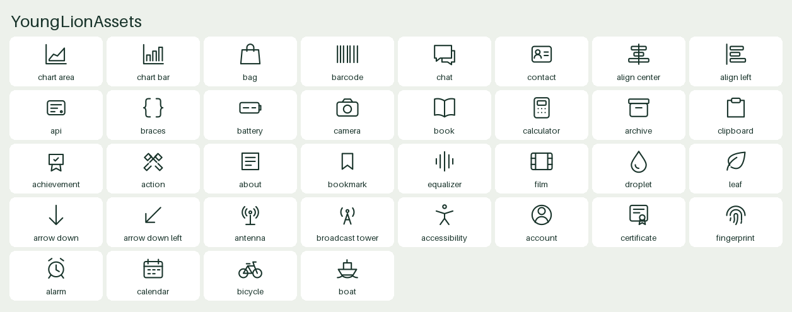

# YoungLionAssets

A collection of **676 outline icons in 18 categories** for interfaces, developer tools, and games. Every icon comes as an SVG and two transparent 256 × 256 PNGs.

[Türkçe](README.tr.md) · [Browse the catalog](CATALOG.md) · [Download ZIP](https://github.com/YoungLionOrganization/YoungLionAssets/archive/refs/heads/main.zip)



## Use the assets

- `assets/svg/` contains 64 × 64 vectors that inherit `currentColor`. Inline an SVG to color it with surrounding CSS.
- `assets/png/` contains dark green icons for light backgrounds.
- `assets/png-light/` contains near-white icons for dark backgrounds.
- [manifest.json](manifest.json) lists each icon's category, origin, and file paths. [migration.json](migration.json) maps the 78 original filenames without extensions to current IDs.
- [brand/](brand/) contains the supplied YoungLion logo in SVG and PNG, and the supplied hero image in PNG.

The icon count includes 78 source icons, 241 newly drawn base icons, and 357 simple state icons such as `file-upload`, `message-unread`, and `wifi-off`. Image formats, color exports, and brand files each sit outside that count.

The source icons share one consistent stroke, round joins, and a color-independent SVG format. Sixteen were redrawn. For example, `about` now shows a document, `login` and `logout` show opposite movements relative to the doorway, and `github` uses a generic source-control drawing. Legacy IDs remain available in the migration index.

## Rebuild

Use Python 3.10 or newer and Cairo. Install the dependencies in a virtual environment, then regenerate the SVGs, PNGs, catalog, and previews from the files in `designs/`.

```sh
python -m pip install -r requirements.txt
python scripts/build.py
```

## License

The collection is available under the [MIT License](LICENSE).
