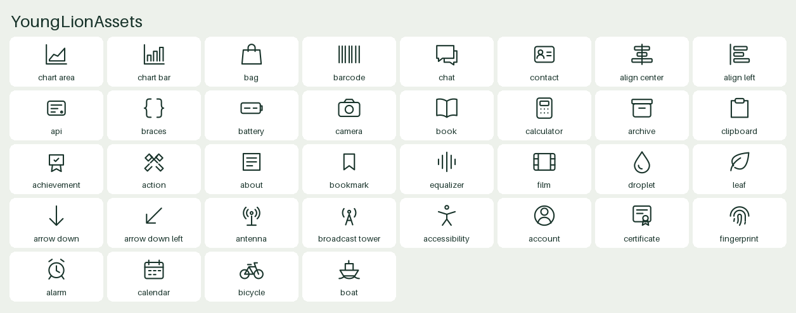

# YoungLionAssets

Arayüzler, geliştirici araçları ve oyunlar için **18 kategoride 676 çizgi ikon**. Her ikonun SVG sürümü ve şeffaf arka planlı iki adet 256 × 256 PNG sürümü var.

[English](README.md) · [İkon kataloğu](CATALOG.md) · [ZIP indir](https://github.com/YoungLionOrganization/YoungLionAssets/archive/refs/heads/main.zip)



## Kullanım

- `assets/svg/` içinde 64 × 64 vektörler var. SVG’yi sayfanın içine yerleştirerek rengini CSS’teki `currentColor` üzerinden ayarlayabilirsin.
- `assets/png/` açık arka planlar için koyu yeşil, `assets/png-light/` koyu arka planlar için beyaza yakın ikonlar içerir.
- [manifest.json](manifest.json) her ikonun kategorisini, kökenini ve dosya yollarını listeler. [migration.json](migration.json) eski 78 dosya adını uzantısız olarak güncel kimliklerle eşleştirir.
- [brand/](brand/) klasöründe kaynak arşivdeki YoungLion logosu SVG ve PNG olarak, kapak görseli ise PNG olarak bulunur.

Koleksiyonda kaynak arşivden 78 ikon, 241 yeni temel çizim ve `file-upload`, `message-unread`, `wifi-off` gibi 357 durum ikonu var. Dosya biçimleri, renk sürümleri ve marka görselleri ayrı ikon sayımına dahil edilmez.

Kaynak ikonlara ortak çizgi kalınlığı, yuvarlak birleşimler ve renkten bağımsız SVG biçimi uygulandı. On altı ikon yeniden çizildi. Örneğin `about` belge simgesi oldu, `login` ve `logout` kapıya göre giriş ve çıkışı gösteriyor, `github` ise genel bir sürüm kontrol simgesi kullanıyor.

## Yeniden üretme

Python 3.10 veya üzerini ve Cairo’yu kullan. Bağımlılıkları bir sanal ortama kurduktan sonra aşağıdaki komutlarla `designs/` altındaki tanımlardan SVG, PNG, katalog ve önizlemeleri oluşturabilirsin.

```sh
python -m pip install -r requirements.txt
python scripts/build.py
```

## Lisans

Koleksiyon [MIT lisansı](LICENSE) altında sunulur.
